# figgyplot

**Plot with NumPy. Edit directly. Reuse the settings in Python.**

Python plotting powered by the Rust [figgy renderer](https://github.com/shim9610/figgy).
Open a native editor, adjust the view and layout, then copy executable Python
settings into a script or apply them across a batch of datasets.

[Quick start](#quick-start) · [Edit → copy → reuse](#edit-once-reuse-across-datasets) ·
[Gallery](#gallery) · [Jupyter](#jupyter) · [Examples](examples/README.md) ·
[Documentation](docs/README.md)

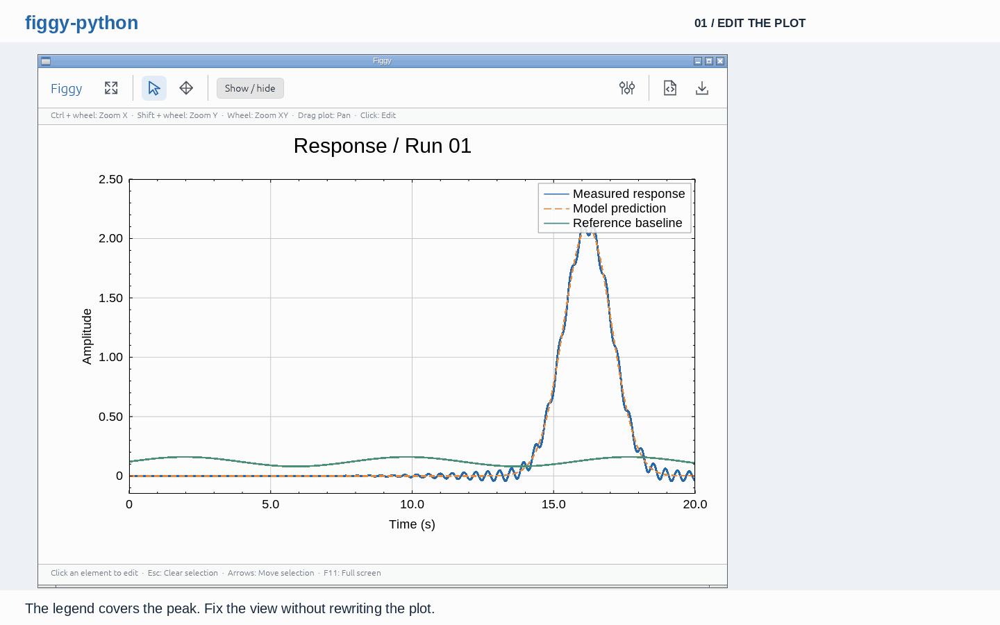

*100,000 samples per series. Edit the native plot, copy Python, paste into
VS Code and run the same settings on three independent datasets.*
[Exported Python](docs/examples/chart_style.py) · [Run the demo](examples/edit_and_reuse.py) ·
[Recording details](docs/README_DEMO.md)

## Gallery

Click a chart to open the Python example that generates it. All data is
synthetic; every image is actual native Figgy output. Each example exports a PNG
and can open the same chart for interactive editing with `--show`.

**Scientific plots**

<table width="100%">
  <tr>
    <td width="33%" align="center">
      <strong>Signals and references</strong><br>
      <a href="examples/line_signals.py">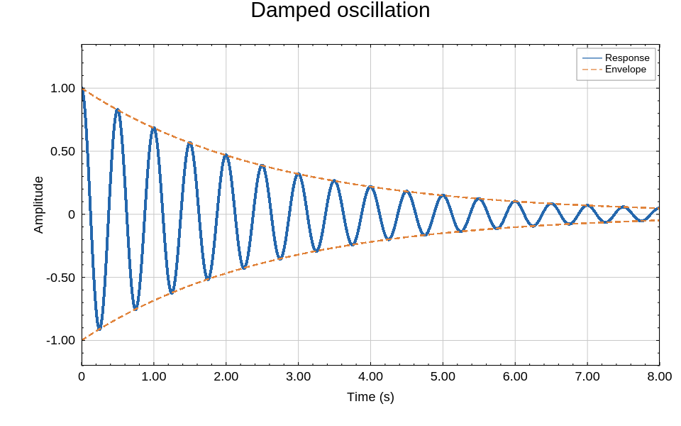</a>
    </td>
    <td width="33%" align="center">
      <strong>Populations and markers</strong><br>
      <a href="examples/scatter_clusters.py">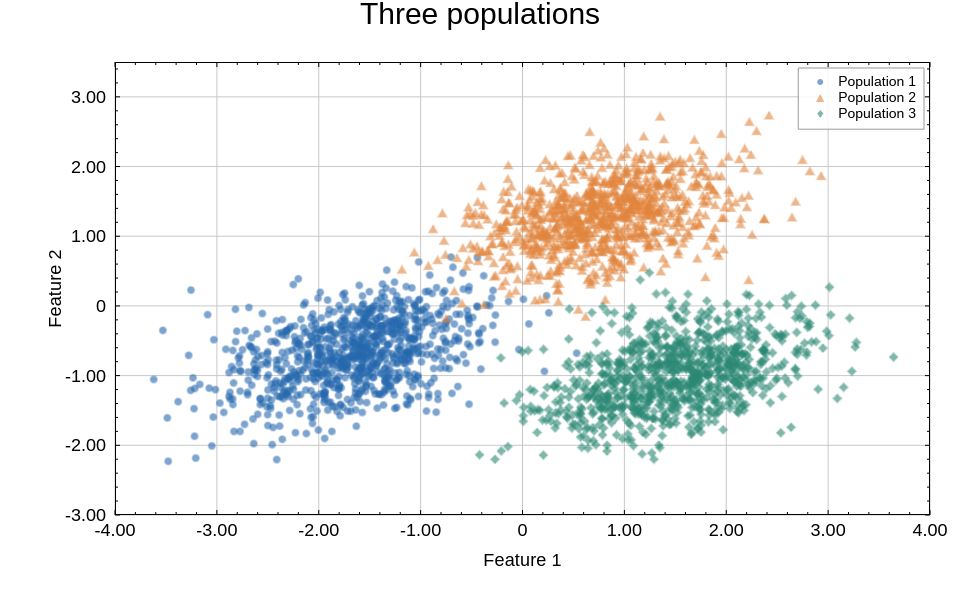</a>
    </td>
    <td width="33%" align="center">
      <strong>Interpolated heatmap</strong><br>
      <a href="examples/heatmap_field.py">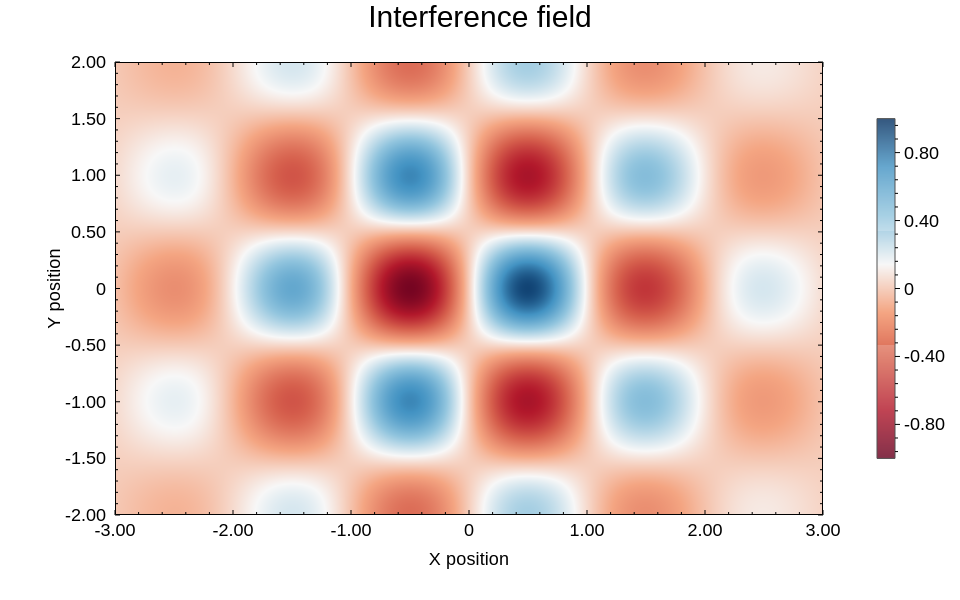</a>
    </td>
  </tr>
  <tr>
    <td width="33%" align="center">
      <strong>Logarithmic axes</strong><br>
      <a href="examples/log_scales.py">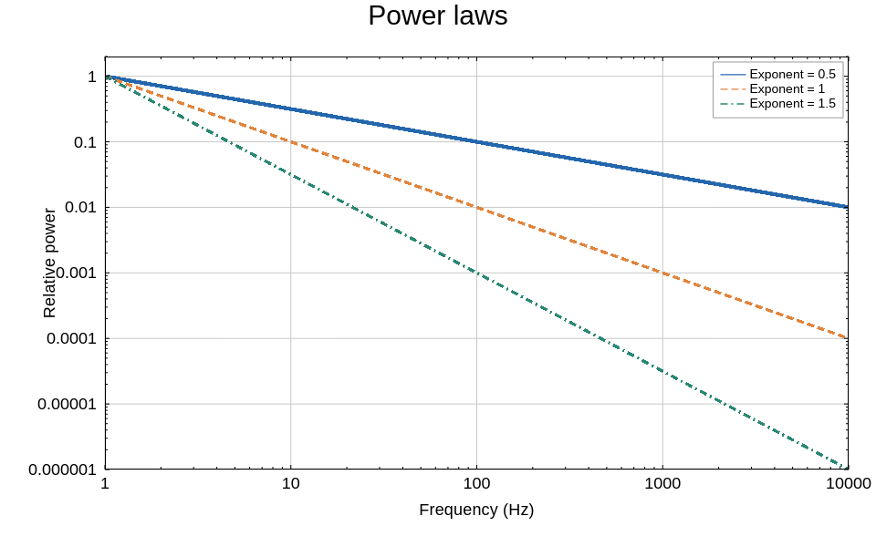</a>
    </td>
    <td width="33%" align="center">
      <strong>Correlation matrix</strong><br>
      <a href="examples/correlation_matrix.py">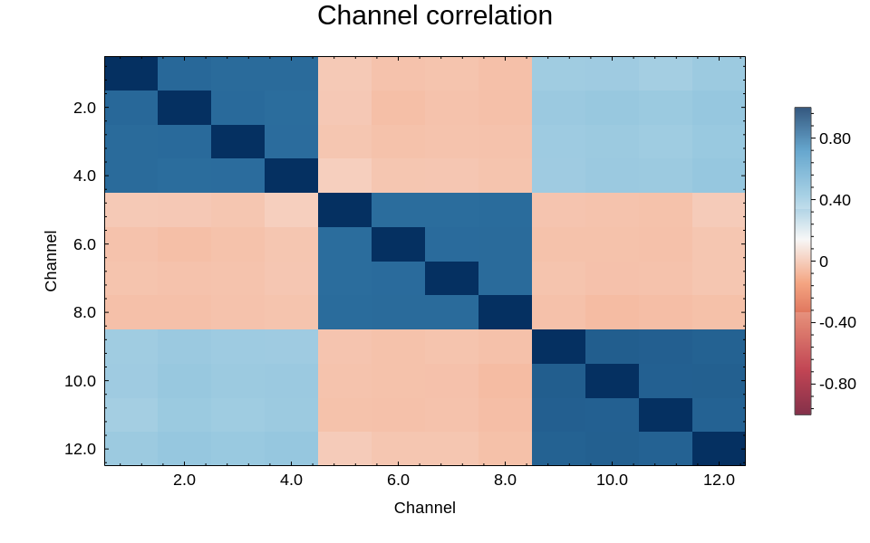</a>
    </td>
    <td width="33%" align="center">
      <strong>Spectrogram</strong><br>
      <a href="examples/spectrogram.py">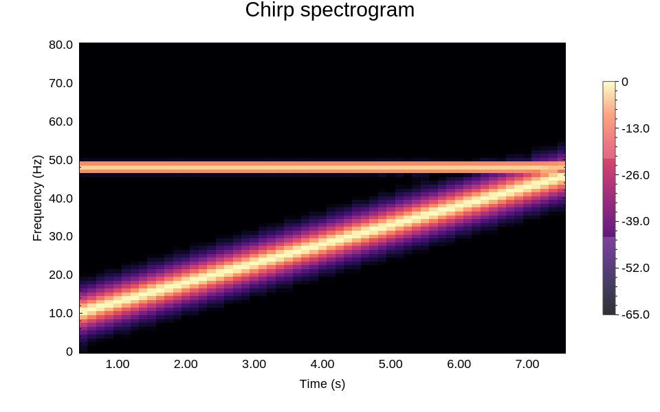</a>
    </td>
  </tr>
  <tr>
    <td width="33%" align="center">
      <strong>Parametric curves</strong><br>
      <a href="examples/parametric_curves.py">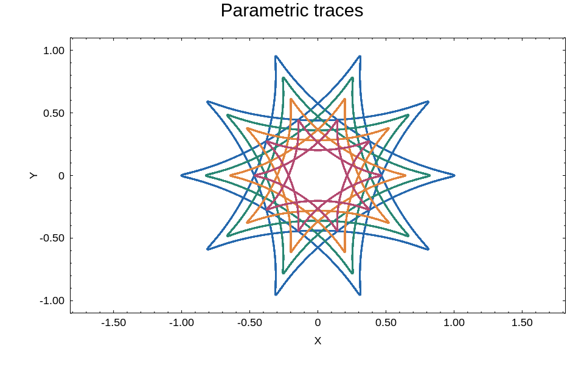</a>
    </td>
    <td width="33%" align="center">
      <strong>Lines and measurements</strong><br>
      <a href="examples/line_markers.py">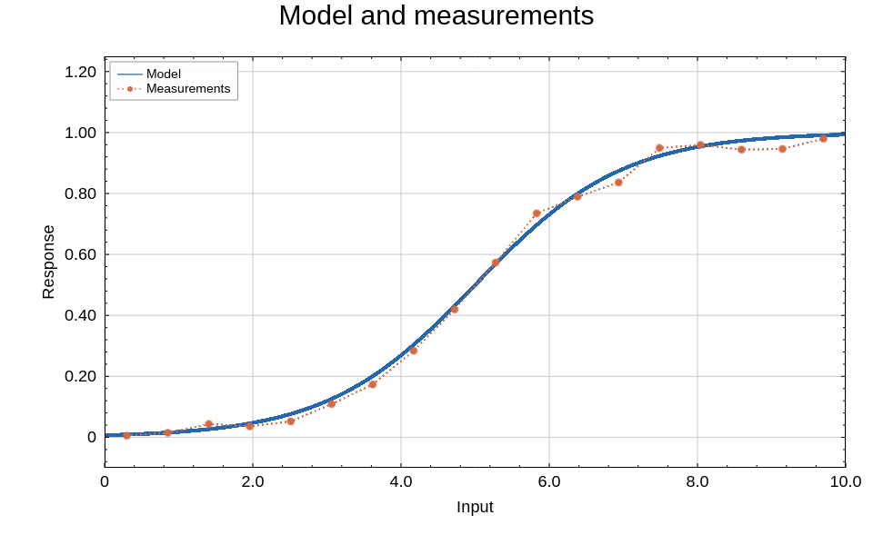</a>
    </td>
    <td width="33%"></td>
  </tr>
</table>

**Draw styles**

<table width="100%">
  <tr>
    <td width="33%" align="center">
      <strong>Sketch / handwriting</strong><br>
      <a href="examples/sketch_style.py">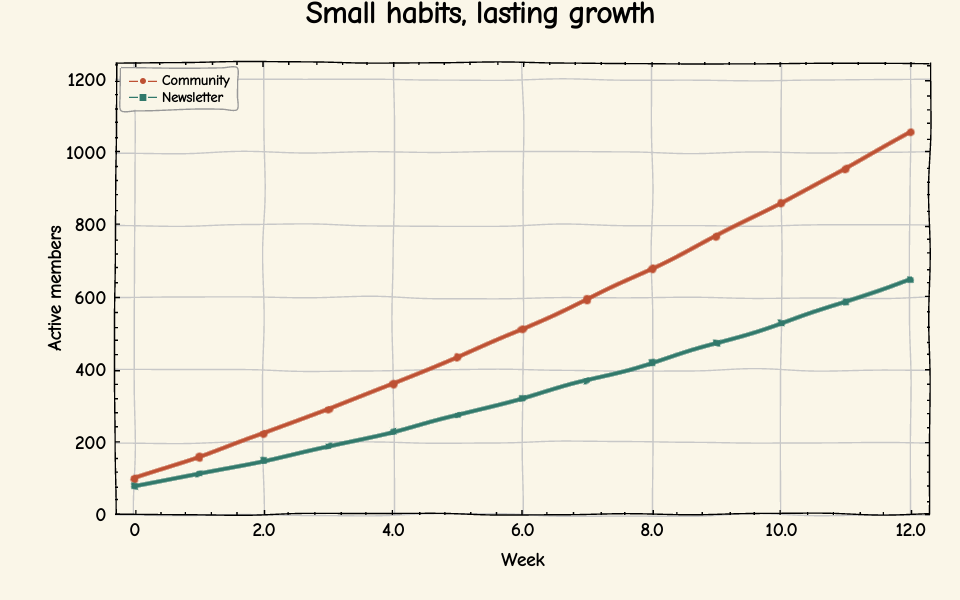</a>
    </td>
    <td width="33%" align="center">
      <strong>Constellation</strong><br>
      <a href="examples/constellation_style.py">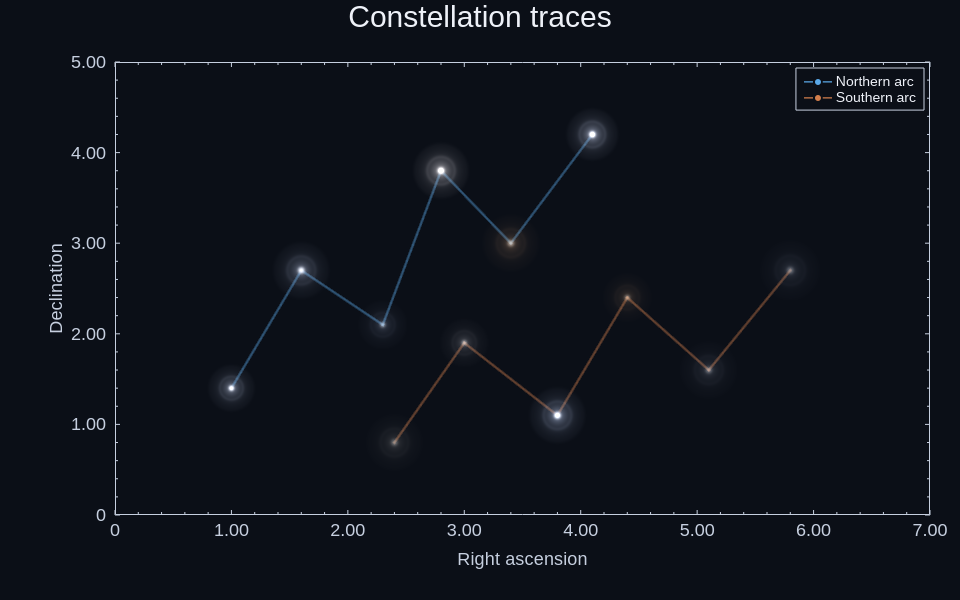</a>
    </td>
    <td width="33%" align="center">
      <strong>Milkyway / lines only</strong><br>
      <a href="examples/milkyway_style.py">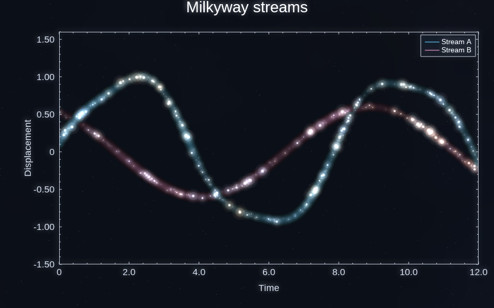</a>
    </td>
  </tr>
</table>

**Pies, donuts and procedural materials**

<table width="100%">
  <tr>
    <td width="33%" align="center">
      <strong>Pie</strong><br>
      <a href="examples/pie_chart.py">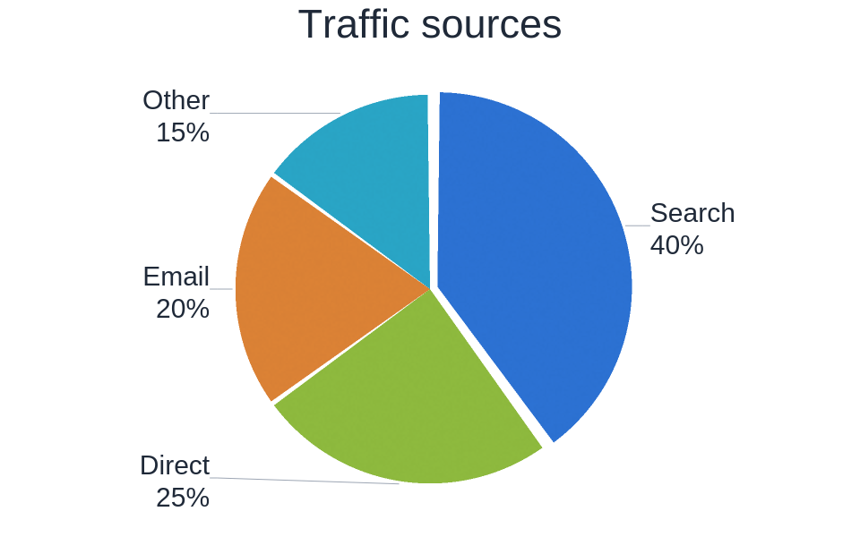</a>
    </td>
    <td width="33%" align="center">
      <strong>Raised ceramic donut</strong><br>
      <a href="examples/donut_chart.py">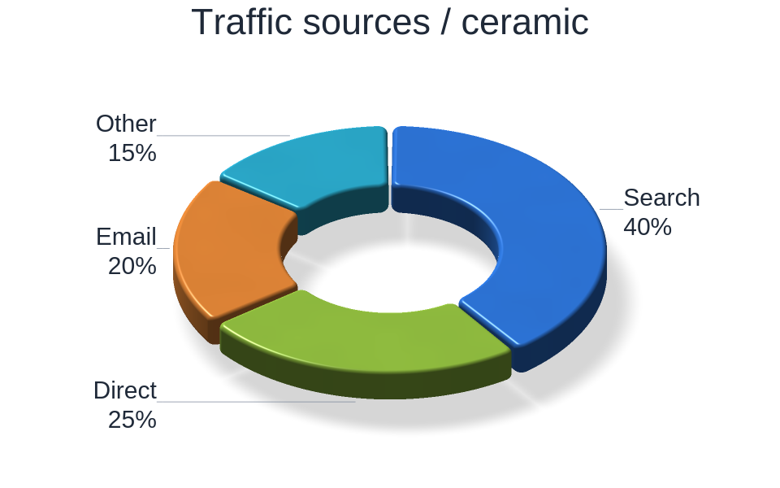</a>
    </td>
    <td width="33%" align="center">
      <strong>Procedural materials</strong><br>
      <a href="docs/images/gallery/material-paper.png">Paper</a> ·
      <a href="docs/images/gallery/material-wood.png">Wood</a> ·
      <a href="docs/images/gallery/material-hatch.png">Hatch</a> ·
      <a href="docs/images/gallery/material-pearl.png">Pearl</a><br><br>
      <a href="examples/material_textures.py">Python recipes</a> ·
      <a href="docs/CHART_TYPES.md">Material API</a>
    </td>
  </tr>
</table>

```bash
python examples/heatmap_field.py                  # Export output/gallery/heatmap-field.png
python examples/scatter_clusters.py --show        # Edit, then save when the window closes
python examples/donut_chart.py --show             # Edit slices, camera and material
python examples/material_textures.py --material pearl
python scripts/render_gallery.py                 # Reproduce all 17 gallery images
```

[Example index and commands](examples/README.md) ·
[Rendering provenance](docs/images/gallery/manifest.json).
[Chart and style API](docs/CHART_TYPES.md) documents pies, donuts, materials and
draw modes, including the line-only Milkyway restriction.

## What you can do

- **Edit the plot you are looking at.** Zoom each axis around the pointer, pan the
  view, drag the legend or titles, and adjust text, colors, line widths and ranges.
- **Keep the result as code.** Copy Python produces familiar calls such as
  `ax.set_title(...)` and `ax.set_xlim(...)`, plus readable patches for advanced
  layout and styling. Save PNG exports the current chart.
- **Reuse a layout across datasets.** Apply the exported code to figures with
  matching series IDs and DPI. Their data stays independent.
- **Work in separate windows or Jupyter.** Native figures share a GPU context;
  Jupyter renders through WASM/WebGPU in the browser.

## Install

Install from **PyPI** with **Python 3.8–3.15**:

```bash
python -m pip install figgyplot
# Interactive Jupyter editor:
python -m pip install 'figgyplot[notebook]'
```

A compatible Windows, macOS or Linux wheel needs no Rust compiler and includes
the notebook JS/WASM assets. TestPyPI is used to verify upcoming releases;
[the publishing guide](docs/PUBLISHING.md) documents that developer workflow.

Alternatively, install from source with **Python 3.8–3.15**, **Rust 1.99+**,
a system C/C++ toolchain and an available graphics driver:

```bash
git clone https://github.com/shim9610/figgy-python.git
cd figgy-python
python -m venv .venv
source .venv/bin/activate
python -m pip install --upgrade pip
python -m pip install .
```

On Windows, activate with `.venv\Scripts\Activate.ps1` and use MSVC C++ Build
Tools. On macOS, use Xcode Command Line Tools. Native desktop rendering uses
wgpu (Vulkan on Linux, DX12 on Windows, Metal on macOS); Metal support is
experimental. The native editor does not require Qt or PySide6.

Linux X11 windows additionally need the system keyboard libraries
`libxkbcommon0` and `libxkbcommon-x11-0` (Debian/Ubuntu package names), plus the
window system and GPU driver. Minimal/headless Linux images may omit these
libraries even when offscreen rendering works.

The distribution/import name is **figgyplot**, independent of the unrelated
`figgy` package on PyPI. The repository name remains `figgy-python`.
[Platform/Python coverage and release status](docs/DISTRIBUTION.md) distinguish
configured wheels from executed verification. Wheel CI remains manual only.

Contributions follow the [contributing guide](CONTRIBUTING.md) and
[code of conduct](CODE_OF_CONDUCT.md). For private vulnerability reports, see
[the security policy](SECURITY.md). [Repository setup and PR CI rollout](docs/REPOSITORY_SETUP.md)
describe the prepared security workflows and main-branch check names.

For a source checkout, add notebook support with
`python -m pip install ".[notebook]"`. The WASM assets are included in the package; normal installation does not require a WASM build.

## Quick start

```python
import numpy as np
import figgyplot as figgy

x = np.linspace(0, 20, 100_000, dtype=np.float32)
fig, ax = figgy.subplots(backend="native", figsize=(8, 5), dpi=120)
ax.plot(x, np.sin(x), color="#2467ad", label="Signal", id="signal")
ax.set_title("Interactive signal", fontsize=18)
ax.set_xlabel("Time (s)")
ax.set_ylabel("Amplitude")
ax.legend()

try:
    fig.show()                  # Edit the chart; close the window to continue.
    fig.savefig("edited.png")  # Saves the edited figure, without the editor UI.
finally:
    fig.close()
```

A small `figgy.pyplot` interface is also available. The API is familiar to
matplotlib users, but does not implement the full matplotlib API.

| Native editor input | Action |
| --- | --- |
| Ctrl + wheel | Zoom X around the pointer |
| Shift + wheel | Zoom Y around the pointer |
| Wheel | Zoom X and Y around the pointer |
| Drag inside the plot | Pan the view |
| Drag a title or legend | Move that element |
| Click an element | Open its properties |
| Show / hide | Toggle titles and legend, including hidden elements |
| Esc / arrow keys | Clear / move the current selection |

Layout mode moves or resizes the plot area. The properties panel keeps the chart
size and aspect ratio; it overlays the chart in maximized/full-screen windows.

## Edit once, reuse across datasets

Run the example shown in the GIF:

```bash
python examples/edit_and_reuse.py --output output/edit-and-reuse
```

1. The automatic upper-right legend covers the late response peak. Use Ctrl/Shift
   + wheel to adjust the axes, widen the left margin in Layout mode, position the
   Y-axis title and drag the legend into the empty upper-left corner.
2. **Copy Python** puts the edited settings on the clipboard. It includes axis
   ranges, text, visibility, legend position and series styling.
3. Close the first window. The example saves `chart_style.py`, applies it to three
   different datasets, writes three PNGs and opens the resulting figures.

The exported code uses setters for common properties:

```python
ax = fig.axes[0]
ax.set_title("Response / Run 01", fontsize=18)
ax.set_xlabel("Time (s)", fontsize=11)
ax.set_ylabel("Amplitude", fontsize=11)
ax.set_xlim(2.5, 17.5)
ax.set_ylim(0.0, 2.7)
# The complete export also preserves legend placement and advanced styling.
```

Ranges, ticks and titles:

- Property-panel edits and `fig.update("axis_bottom", major_spacing=2)` share
  changed fields with the opposite axis when the pair had exactly equal `min`,
  `max`, `scale` and `inverted` values before the edit. The same rule applies in
  either direction to bottom/top and left/right, including `tick_labels_*` edits.
  For example, `fig.update("tick_labels_right", format="Scientific",
  significant_digits=4)` changes only those label fields on a matching left/right
  pair. Unedited differences in fonts, colors or tick settings remain intact.
  Axis-line visibility, titles, margins and offsets remain independent. Different
  coordinate ranges/scales remain independent too; comparison uses exact values
  without rounding. Use the raw SSOT APIs below for a deliberate one-sided edit.
- `ax.set_xlim(a, b)` / `set_ylim` set the range and derive readable ticks for it.
  To keep tick spacing you chose explicitly, use `ax.set_xlim_without_tick_auto(a, b)`
  / `set_ylim_without_tick_auto`. These change only the paired axes' SSOT bounds;
  they do not create a persistent range lock. Plot-creation helpers fit the data
  again when adding a series, and `fig.fit()` explicitly fits all axes. Apply
  manual ranges after adding the series when they should be the final view.
- `fig.fit()` and both UI Fit buttons use zero padding for figures containing
  only heatmaps, contours or filled contours, including combinations. Mixing in
  lines, scatter or other Cartesian series uses 5%. Explicit padding overrides
  either default: `fig.fit(padding=0.05)` adds 5%, while `fig.fit(padding=0)` fits
  tightly to the rendered data extent.
- For selective control, use `fig.configure(config={...})` or read the current
  state with `fig.get_settings()`, edit only the intended fields, then submit it
  through `fig.apply_settings(state)`. For example:

  ```python
  fig.configure(config={"bottom_x": {"min": 20.0, "max": 80.0}})
  ```

  This preserves that axis's tick and label settings and leaves the top axis
  untouched. Include `top_x` too when the pair should share bounds. In contrast,
  `set_xlim` / `set_ylim` choose ticks and label formatting, `fit` also derives
  bounds from data, and title helpers can enlarge the title band. Direct SSOT
  edits do not run these adjustments. Rendering still validates settings and
  applies safety limits; visible tick positions and label counts depend on range.
- A tick setting the renderer cannot draw as written is replaced: a spacing that
  would draw thousands of ticks falls back to automatic spacing, and `minor_count`
  is capped at 99. Each change is reported once as a `figgy.RenderWarning` by the next
  native PNG/RGBA render (`render_rgba`, `to_png`, `savefig`, the PNG widget). Desktop
  windows and the browser (webgpu) backend do not report it.
- `fig.update("chart_title", text="Line 1\nLine 2", align="center")` aligns the
  lines of multi-line text (`left`, `center`, `right`); a title taller than its band
  grows the band instead of being clipped. Unicode super/subscripts such as `10⁻³`
  are drawn as super/subscript text.
- `font=` must name an installed family or `"Liberation Sans"` (or `""` for the
  default); an unknown name raises `ValueError` on the native backend. The browser
  backend cannot see installed fonts and draws an unknown family with the bundled font.
  Characters a font lacks are drawn from another available font (natively including
  installed fonts).

To reuse the saved code yourself, from the repository root:

```python
from pathlib import Path
from examples.edit_and_reuse import make_figure

style_code = Path("output/edit-and-reuse/chart_style.py").read_text()
for run in range(3):
    with make_figure(run) as fig:
        exec(style_code, {"fig": fig})
        fig.axes[0].set_title(f"Response / Run {run + 1:02d}")
        fig.savefig(f"run-{run + 1:02d}.png")
```

You can also obtain the code directly with `edited_fig.to_code()`. An export
contains settings, not NumPy arrays: recreate the plotted series with the same
IDs, kinds and DPI before applying it. Axis ranges and titles are included;
override them afterward when a dataset needs different values. Advanced settings
use `fig.configure(...)` with ordinary Python dictionaries.

## Multiple windows

Open each figure without blocking, then run the shared event loop:

```python
from figgyplot.desktop import run_events

fig.show(block=False)
fig2.show(block=False)
run_events()
```

Each window can close independently. Run window creation and event processing on
the Python main thread. For an external main-thread loop, call
`figgy.desktop.poll_events()` regularly. See the complete
[multiple-window example](examples/multiple_windows.py).

## Jupyter

```bash
python -m pip install jupyterlab ".[notebook]"
jupyter lab examples/interactive.ipynb
```

```python
import numpy as np
import figgyplot as figgy

fig, ax = figgy.subplots(backend="webgpu")
x = np.linspace(0, 20, 100_000, dtype=np.float32)
ax.plot(x, np.sin(x), id="signal", label="Signal")
ax.set_title("Edit in the browser")
ax.legend()
display(fig)
```

The browser owns rendering and interaction after the initial data transfer; a
GPU in the notebook kernel is not required. WebGPU needs a supported browser and
HTTPS or localhost. `backend="auto"` chooses WebGPU in an IPython kernel and
native rendering elsewhere.

Wait for pending browser edits before reading or exporting the Python state:

```python
await fig.sync()
code = fig.to_code()
await fig.savefig_async("edited.png", dpi=240)
```

Create all series before displaying the widget. Browser export is asynchronous;
there is no silent fallback when WebGPU is unavailable. An explicit kernel PNG
fallback is available when a native kernel GPU exists. See
[notebook and host details](docs/HOSTS.md).

## Examples

See the [complete example index](examples/README.md) for gallery recipes,
commands and expected outputs.

| Example | Purpose |
| --- | --- |
| [edit_and_reuse.py](examples/edit_and_reuse.py) | Edit one chart, export Python, apply it to three datasets |
| [desktop_editor.py](examples/desktop_editor.py) | Open a native editor with an adjusted example layout |
| [multiple_windows.py](examples/multiple_windows.py) | Edit independent figures in separate windows |
| [quickstart.py](examples/quickstart.py) | Plot and export a PNG |
| [interactive.ipynb](examples/interactive.ipynb) | Browser WebGPU editing in Jupyter |

## Scope and performance

The Python API provides **line/scatter/errorbar plots, histograms, heatmaps, contours, categorical bars, boxplots, pies and donuts**, with
multiple series on one Axes, linear/log and inverted axes, picking, editable
text/legend/styles, and PNG export. Cartesian plots support Precise, Sketch,
Constellation and Milkyway draw modes. **Milkyway accepts line-only series;
scatter and marker lines are intentionally disabled.** Constellation uses
marker lines so stars remain at source samples.

Pies/donuts on both native and browser WebGPU hosts expose 11 upstream materials, camera tilt, extrusion, rounded
corners, textures and slice editing. Their bounded model contains up to 64
categories and uses the upstream radial renderer on the shared GPU device.
All chart families support native desktop and Jupyter WebGPU editing and PNG export.
Categorical bars and boxplots use their upstream bounded models; histograms and
contours use resident Cartesian columns. Multi-panel figures remain unsupported.

`figsize` is in inches; `fontsize`, `linewidth` and `markersize` use points.
Native Cartesian arrays are uploaded to a resident GPU column pool and reused during edits.
Source-array mutations do not change the figure after upload. There is no
automatic downsampling or streaming fallback; exceeding a device’s allocation
limit raises an error. `fig.close()` releases a figure’s resources;
`figgy.release_gpu()` releases the shared native context after all figures close.

See the measured [Linux / Radeon 8060S results](benchmarks/LINUX_GPU_RESULTS.md)
and [Windows results](benchmarks/WINDOWS_GPU_RESULTS.md), including methodology,
first-frame cost and limitations. RGBA readback timings and surface submission
rates are reported separately; they are not monitor FPS measurements.

## Renderer and documentation

This package uses **figgy-renderer 0.17.0** from the upstream
[figgy repository](https://github.com/shim9610/figgy). Until 0.17.0 is on crates.io,
the native extension and the packaged browser kernel are both built from figgy
commit `bf665c0` (a `[patch.crates-io]` override in `Cargo.toml`). Rust owns chart layout,
rendering, picking and drag policies; this repository adds the NumPy-facing API,
native editing host, browser widgets and Python settings export.

- [Desktop editor guide](docs/DESKTOP_EDITOR.md) — controls and screenshots
- [Documentation index](docs/README.md) — user guides and validation reports
- [Chart and style API](docs/CHART_TYPES.md) — pies, donuts, materials and draw modes
- [Host architecture](docs/HOSTS.md) — native and notebook integration
- [GPU preparation](docs/PREPARATION.md) — explicit first-use preparation
- [Native resource sharing](docs/NATIVE_SHARING.md) — ownership and memory limits
- [Validation records](docs/HOST_VALIDATION.md) — tested environments and coverage
- [Demo reproduction](docs/README_DEMO.md) — recording and batch verification

Licensed under [MIT](LICENSE-MIT) OR [Apache-2.0](LICENSE-APACHE). Bundled assets retain their respective
licenses; see [third-party notices](THIRD_PARTY_NOTICES.md).
