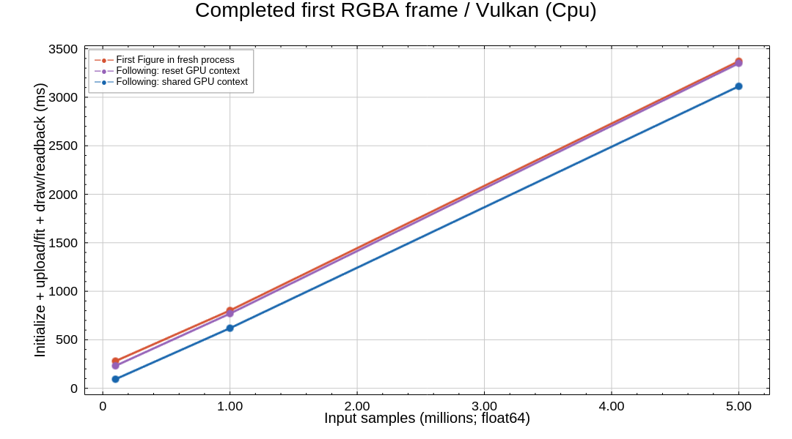

# Native sharing: completed first-frame measurements

Historical 0.2 measurement report. These numbers have not been remeasured for
`figgyplot 0.3.0` / renderer `0.17.0` / model `0.11.0`; the source revision below
defines the measured implementation.

Measured on the native implementation at `cb252ebc9bb82e40fda1b4060d06e6789b38b562`,
Figgy Python 0.2.0 / figgy-renderer 0.16.1. Linux, CPython 3.12.14, Vulkan llvmpipe
LLVM 19.1.7 **software GPU**, no physical GPU. These are not new Windows RTX 4070 Ti
results.

**Sharing reduces the first-frame cost of subsequent new Figures.** The largest
benefit in this run is at 100,000 points. At 5 million points, software rendering
dominates; the overall reduction is modest and run-to-run variation matters.

## First-frame totals

Smooth line, float64 inputs, 2.5 px line width, 960×600 completed RGBA readback.
Times are medians in milliseconds. `prepare()` is **never called**.

| Points | First Figure in fresh process | Following Figure, GPU reset each time | Following Figure, shared GPU | Shared vs reset |
|---:|---:|---:|---:|---:|
| 100,000 | 280.34 | 231.57 | **93.66** | 2.47× |
| 1,000,000 | 802.00 | 769.89 | **619.61** | 1.24× |
| 5,000,000 | 3,370.93 | 3,350.24 | **3,112.87** | 1.08× |

The fresh-process comparison includes more process-local first-use effects such
as font initialization. Reset-following versus shared-following is the closer
control for resource sharing: both run after a first chart, with process/font
caches available. Reset-following explicitly calls `release_gpu()` after closing
each Figure; it is a control using the implementation at that checkpoint, not a measurement
of an older Git commit.

## Where time changes

Component medians in milliseconds (component medians need not sum to the median
total). The control below compares following Figures with and without retaining
the GPU context.

| Points | Mode | Constructor | Upload + fit | First draw + completed readback |
|---:|---|---:|---:|---:|
| 100,000 | Reset | 35.13 | 87.49 | 112.45 |
| 100,000 | Shared | 0.28 | 10.64 | 85.36 |
| 1,000,000 | Reset | 33.36 | 150.67 | 576.92 |
| 1,000,000 | Shared | 0.29 | 66.94 | 553.30 |
| 5,000,000 | Reset | 33.93 | 440.39 | 2,855.78 |
| 5,000,000 | Shared | 0.28 | 325.95 | 2,801.52 |

The improvement is primarily avoided device/renderer initialization, installed
pipeline/fit resources, and existing pool capacity. It is the combined context,
renderer and pool reuse effect, not an isolated pool-only optimization.
Every new Figure still uploads both source columns. It is not automatic data
deduplication, and it does not eliminate data transfer, draw or readback work.
The earlier 88 ms → 0.30 ms constructor observation alone was not a first-frame
measurement; this experiment now measures the whole completed first-frame path.

## Method and validation

- For each size, five repetitions launch a fresh shared worker and a fresh reset
  worker, alternating their order. Each worker renders one process-first Figure
  and three following Figures, closing each before creating the next.
- Totals include Figure creation + registration/fit + `render_rgba()` completion,
  matching the first-frame components in `compare.py`. Imports, input generation,
  validation, prior Figure close and explicit reset are excluded.
- Fresh-process medians contain 10 samples per size; following medians contain 15
  samples per mode/size. Three samples in one worker are correlated. Raw per-run
  values and paired worker ratios are retained, not presented as independent
  statistical confidence or a guaranteed speedup.
- Each of the 120 frames has the expected shape and colored chart pixels. Exact
  SHA-256 of complete pixels matches across new Figures, fresh workers and modes
  for each input size. Each frame reports 2 column uploads, 1 RGBA readback and
  0 PNG encodes, with no explicit preparation. Shared context ids stay constant;
  reset context ids change after every close/release.
- No downsampling or mode transition occurs. Inputs are float64 and use the
  unchanged hi/lo upload path. Driver/OS caches were **not cleared**; a fresh
  process is not a cold-driver measurement.

Per-repetition speedup ratios (reset worker's median following total divided by
shared worker's median following total) range from 2.28–3.11× at 100,000 points,
1.17–1.53× at 1 million, and **0.99–1.35× at 5 million**. One 5-million repetition
was slightly slower with sharing; the 1.08× aggregate result should be treated as
a modest observation with variability.

The original comparison benchmark still launches an isolated process per
condition. Global sharing does not automatically turn that process-first metric
into a shared-following metric. Real window surface FPS and input latency are
different measurements. Hardware GPU rendering is much faster than llvmpipe;
Windows/macOS magnitudes and ratios require measurement on those platforms.

## Reproduce

```bash
python benchmarks/first_frame_reuse.py --repeats 5 --following 3 \
  --output benchmarks/results/first-frame-reuse.json \
  --plot docs/images/first-frame-reuse.png
```

Use `--kinds scatter` or `--signal noisy` for additional workloads; only smooth
lines are included in the results above. The graph itself, including axes,
title and legend, is rendered with **Figgy**, and PNG encoding occurs after all
measurement workers finish.

Raw results: [linux-software-first-frame-reuse.json](results/linux-software-first-frame-reuse.json).


