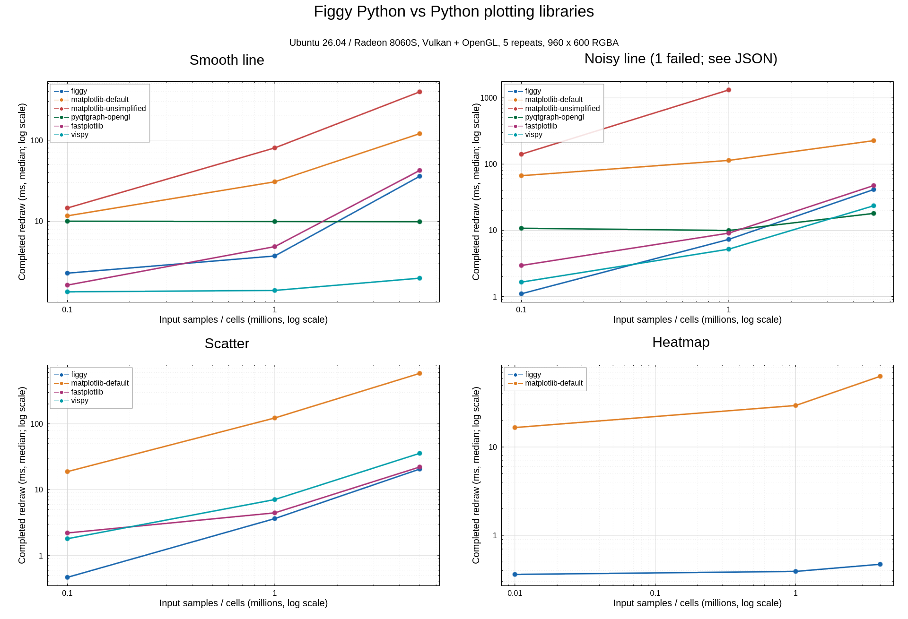

# Linux Radeon 8060S benchmarks

Historical hardware report. The measurements and test totals below belong to
the 0.2 checkpoint; they have not been remeasured for `figgyplot 0.3.0` /
renderer `0.17.0` / model `0.11.0`.

2026-10-14 (Asia/Seoul). Figgy 0.2.0, release build of source `abae8d9` at the
measurement checkpoint.

## Environment and method

- Ubuntu 26.04.1 LTS / Linux 7.0.0-38-generic; AMD Ryzen AI Max+ 395,
  16 cores/32 threads; approximately 45 GiB system RAM.
- Radeon 8060S integrated GPU. Vulkan: RADV STRIX_HALO; OpenGL: radeonsi/ACO
  4.6; Mesa 26.0.8-1ubuntu0.3. Hardware GPU, not software rendering.
- AC power, balanced system profile, CPU powersave governor, GPU performance
  level auto. Power and clock settings were left unchanged.
- Python 3.14.4, NumPy 2.5.4, matplotlib 3.11.2, fastplotlib 0.7.0 /
  pygfx 0.17.0 / wgpu-py 0.32.0, VisPy 0.17.0, pyqtgraph 0.14.0 /
  PySide6 6.12.0.
- Independent process per condition; identical float64 inputs and fixed noise
  seed; timing ends after completed 960×600 RGBA readback. Repeated draw,
  axis edit and color edit each report the median of five runs.
- Imports/input generation are excluded. Initialization, coordinate conversion,
  registration/fit and first draw are included in first-frame totals. OS/font/
  driver caches were not cleared.
- Figgy/fastplotlib use Vulkan; VisPy/pyqtgraph use actual OpenGL. Qt uses
  Wayland. Actual pyqtgraph paintGL execution and a physical 960×600 framebuffer
  were verified.
- Lines are 2.5 px; scatter diameter is 5 px. No downsampling. Figgy uses
  float64 hi/lo GPU coordinates; other GPU libraries use float32. AA and axis
  placement differ, so this is not a comparison at identical pixel quality.
- Figgy uses shader AA; fastplotlib defaults to AA off; VisPy lines use GL AA
  off and scatter uses 1 px marker AA; pyqtgraph uses AA off. Peak RSS includes
  inputs, library and driver allocations; it does not measure VRAM.
- Earlier Windows measurements used Figgy 0.1.0, RTX 4070 Ti and Python 3.13.1.
  Hardware/version differences prevent attributing timing differences to the OS.

## Repeated RGBA rendering (ms)

| Workload | Samples | Figgy | fastplotlib | VisPy | pyqtgraph OpenGL | matplotlib default |
|---|---:|---:|---:|---:|---:|---:|
| Smooth line | 100,000 | 2.30 | 1.64 | 1.35 | 10.03 | 11.69 |
| Smooth line | 1,000,000 | 3.74 | 4.88 | 1.41 | 9.95 | 30.70 |
| Smooth line | 5,000,000 | 35.95 | 42.41 | 1.99 | 9.89 | 120.30 |
| Noisy line | 100,000 | 1.10 | 2.95 | 1.65 | 10.73 | 66.79 |
| Noisy line | 1,000,000 | 7.30 | 9.07 | 5.19 | 9.94 | 113.70 |
| Noisy line | 5,000,000 | 41.30 | 47.40 | 23.50 | 18.00 | 225.91 |
| Scatter | 100,000 | 0.47 | 2.21 | 1.81 | — | 18.82 |
| Scatter | 1,000,000 | 3.65 | 4.45 | 7.09 | — | 122.69 |
| Scatter | 5,000,000 | 20.57 | 22.13 | 35.68 | — | 583.06 |

At five million samples, Figgy took 35.95 ms for smooth lines, 41.30 ms for
noisy lines and 20.57 ms for scatter. VisPy and pyqtgraph OpenGL were faster
for lines; Figgy was fastest for scatter. Compared with default matplotlib,
Figgy's repeated rendering was approximately 3.35×, 5.47× and 28.35× faster,
respectively, on this machine.

## First frame, edits and memory: five million samples

| Workload | Backend | First frame (ms) | Axis edit (ms) | Color edit (ms) | PNG (ms) | Peak RSS (MiB) |
|---|---|---:|---:|---:|---:|---:|
| Smooth line | figgy | 152.81 | 36.19 | 36.37 | 39.12 | 224.1 |
| Smooth line | fastplotlib | 807.59 | 43.22 | 43.13 | 53.88 | 511.1 |
| Smooth line | vispy | 375.59 | 4.54 | 1.89 | 14.04 | 385.3 |
| Smooth line | pyqtgraph-opengl | 116.09 | 10.08 | 21.84 | 15.40 | 431.0 |
| Smooth line | matplotlib-default | 225.77 | 119.52 | 120.23 | 135.84 | 412.8 |
| Noisy line | figgy | 162.56 | 43.90 | 43.17 | 48.31 | 231.6 |
| Noisy line | fastplotlib | 810.35 | 46.61 | 45.75 | 65.06 | 507.8 |
| Noisy line | vispy | 396.89 | 25.10 | 22.82 | 35.17 | 388.3 |
| Noisy line | pyqtgraph-opengl | 157.11 | 26.07 | 41.75 | 34.73 | 438.4 |
| Noisy line | matplotlib-default | 337.35 | 232.98 | 233.57 | 246.98 | 399.2 |
| Scatter | figgy | 148.88 | 21.86 | 20.98 | 31.80 | 231.0 |
| Scatter | fastplotlib | 816.15 | 22.48 | 21.47 | 37.02 | 491.8 |
| Scatter | vispy | 526.03 | 40.19 | 165.67 | 71.13 | 1187.6 |
| Scatter | matplotlib-default | 673.59 | 583.75 | 581.21 | 590.43 | 393.7 |

VisPy scatter color edits include resending coordinates as required by its
public API. Figgy's repeated draws and axis/style edits retained the same two
resident column uploads.

## Heatmaps

| Cells | Figgy first frame (ms) | matplotlib first frame (ms) | Figgy repeated (ms) | matplotlib repeated (ms) |
|---:|---:|---:|---:|---:|
| 10,000 | 118.50 | 40.88 | 0.36 | 16.60 |
| 1,000,000 | 132.97 | 56.74 | 0.39 | 29.50 |
| 4,000,000 | 321.11 | 97.40 | 0.47 | 63.14 |

Both heatmap paths include a colorbar. At four million cells, repeated rendering
was 0.47 ms for Figgy versus 63.14 ms for matplotlib, approximately 134× apart.
First-frame time favored matplotlib: 97.40 ms versus 321.11 ms for Figgy. Figgy
reuses resident matrix data; this workload does not reupload all four million
cells on each draw.

## Context reuse and native surface

The separate first-frame campaign covered line/scatter × three sizes × five
repeats × shared/reset modes: 60 independent processes and 240 completed frames.
Pixel SHA-256 matched for identical inputs across modes/processes. Every Figure
had two uploads, one readback and zero PNG encodes.

| Workload | Samples | First Figure in a new process (ms) | Later Figure, shared context (ms) | Later Figure, reset context (ms) |
|---|---:|---:|---:|---:|
| line | 100,000 | 83.66 | 3.17 | 36.99 |
| line | 1,000,000 | 75.76 | 15.63 | 45.88 |
| line | 5,000,000 | 135.65 | 84.51 | 115.40 |
| scatter | 100,000 | 79.18 | 2.95 | 34.71 |
| scatter | 1,000,000 | 81.69 | 17.79 | 51.61 |
| scatter | 5,000,000 | 142.01 | 90.45 | 124.29 |

A 100,000-point native Wayland surface completed 120 submissions in 1.210 s,
reporting **99.14 submitted frames/s**. Surface size was 1260×700 at scale 1.0,
with two initial uploads, zero RGBA readbacks and zero PNG encodes. This is a
CPU-side submission rate, not monitor FPS, completed GPU throughput or
input-to-display latency.

## Validation and errors

- Of 54 comparison conditions, 53 succeeded, one errored and none timed out.
  Successful conditions verified visible data in the first frame, retained data
  in edited PNGs and actual red-color changes for lines/scatter.
- `matplotlib-unsimplified / line / noisy / 5,000,000` raised an Agg cell-block
  limit `OverflowError`. Its original error remains in line JSON; it was not
  converted into a timing result.
- Installed-wheel functional checks: **34 passed, 6 skipped (3.15 s)**. One
  browser test lacked Playwright, two Jupyter tests were opt-in, and three large
  allocation-failure tests exceeded the hardware scope. The X11 input test file
  was excluded on Wayland. This run does not establish browser/X11 interaction
  coverage; later host checks are recorded separately.
- Image review found VisPy's hidden Qt canvas starting at the monitor's default
  2× scale and clipping a 960×600 FBO. VisPy alone was rerun with
  `QT_SCALE_FACTOR=0.5`, verifying logical/physical 960×600 and pixel_scale=1.
  All VisPy timings were replaced; the report/chart use corrected results only.
- The VisPy adapter now rejects `pixel_scale != 1` and records logical/physical
  dimensions. Rejection at scale 1 and complete chart output at scale 0.5 were
  verified. `compare.py` also records Qt scale environment variables.

## Reproduce

```bash
# Install the measured source as a release wheel in the repository .venv.
export WGPU_BACKEND=vulkan
export VK_DRIVER_FILES=/usr/share/vulkan/icd.d/radeon_icd.json
export QT_QPA_PLATFORM=wayland
export QT_SCALE_FACTOR=1
export QT_AUTO_SCREEN_SCALE_FACTOR=0
.venv/bin/python benchmarks/compare.py --sizes 100000 1000000 5000000 --kinds line --signals smooth noisy --backends figgy matplotlib-default matplotlib-unsimplified pyqtgraph-opengl fastplotlib --repeats 5 --timeout 120 --output /tmp/linux-line.json
.venv/bin/python benchmarks/compare.py --sizes 100000 1000000 5000000 --kinds scatter --signals noisy --backends figgy matplotlib-default fastplotlib --repeats 5 --timeout 120 --output /tmp/linux-scatter.json
# This monitor starts hidden Qt canvases at 2x; use 0.5 for VisPy only.
QT_SCALE_FACTOR=0.5 .venv/bin/python benchmarks/compare.py --sizes 100000 1000000 5000000 --kinds line --signals smooth noisy --backends vispy --repeats 5 --output /tmp/linux-vispy-line.json
QT_SCALE_FACTOR=0.5 .venv/bin/python benchmarks/compare.py --sizes 100000 1000000 5000000 --kinds scatter --signals noisy --backends vispy --repeats 5 --output /tmp/linux-vispy-scatter.json
.venv/bin/python benchmarks/compare.py --sizes 10000 1000000 4000000 --kinds heatmap --backends figgy matplotlib-default --repeats 5 --output /tmp/linux-heatmap.json
.venv/bin/python benchmarks/first_frame_reuse.py --sizes 100000 1000000 5000000 --kinds line scatter --repeats 5 --following 3 --output /tmp/linux-reuse.json
.venv/bin/python benchmarks/ui_surface.py --points 100000 --frames 120 --output /tmp/linux-surface.json
.venv/bin/python -m pytest -q -ra --ignore=tests/test_desktop_host.py
```

## Result files

[Line JSON](results/linux-radeon8060s-gpu-line.json) ·
[Line CSV](results/linux-radeon8060s-gpu-line.csv) ·
[Scatter JSON](results/linux-radeon8060s-gpu-scatter.json) ·
[Heatmap JSON](results/linux-radeon8060s-heatmap.json) ·
[Environment, commands and wheel](results/linux-radeon8060s-environment.json) ·
[Test log](results/linux-radeon8060s-tests.txt)

[First-frame reuse](results/linux-radeon8060s-first-frame-reuse.json) ·
[Surface](results/linux-radeon8060s-surface.json) ·
[Corrected VisPy line](results/linux-radeon8060s-vispy-line.json) ·
[Corrected VisPy scatter](results/linux-radeon8060s-vispy-scatter.json) ·
[Chart rendering record](results/linux-radeon8060s-gpu-comparison.rendering.json)

The comparison chart is also rendered with Figgy. Its SVG embeds the finished PNG.


