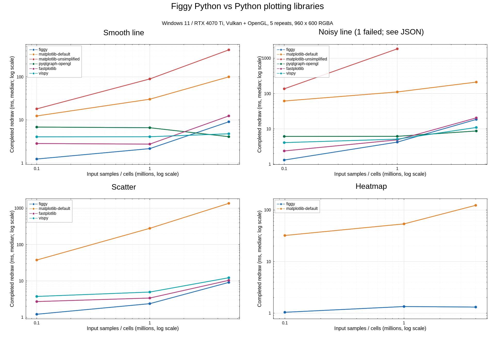

# Windows GPU 라이브러리 비교

2026-10-14 (Asia/Seoul). fastplotlib, VisPy와 실제 pyqtgraph OpenGL 렌더 경로를 추가한 후속 측정입니다.

## 환경과 방법

- Windows 11, Intel Core i7-13700KF, 약 64 GiB RAM, RTX 4070 Ti 12 GiB / NVIDIA 617.14.
- Python 3.13.1, Figgy 0.1.0, fastplotlib 0.7.0 / pygfx 0.17.0 / wgpu-py 0.32.0, VisPy 0.17.0, pyqtgraph 0.14.0 / PySide6 6.12.0.
- 960×600 RGBA readback 완료까지 측정, 각 조건을 독립 프로세스에서 실행하고 5회 중앙값을 기록했습니다.
- 선 2.5 px, 산점도 지름 5 px. 입력은 동일 float64 배열이며 다운샘플링은 사용하지 않았습니다.
- GPU 좌표는 Figgy가 float64 hi/lo, 경쟁 GPU 라이브러리는 float32입니다. pyqtgraph는 중심을 빼고 float32 VBO로 올립니다.
- Figgy/fastplotlib는 Vulkan, VisPy/pyqtgraph는 NVIDIA OpenGL 4.6 경로입니다.
- Figgy는 shader AA, fastplotlib는 기본 pixel_scale=1 / PPAA none / LineMaterial AA off, VisPy 선은 기본 GL AA off, pyqtgraph OpenGL도 AA off입니다. VisPy 산점도는 기본 marker AA 1 px입니다. 같은 픽셀 품질의 비교가 아닙니다.
- Figgy와 경쟁 라이브러리의 plot viewport를 맞췄습니다. pyqtgraph는 Qt 경계 때문에 0.5 px 차이가 있습니다. 축/그리드 배치와 초기 자동 축 범위는 라이브러리마다 다릅니다.
- import/입력 생성은 타이밍에서 제외하고, 자료 형식 변환과 등록/fit은 포함했습니다. 초기화·첫 프레임·반복·축 변경·스타일 변경·PNG를 분리했습니다.
- warm 반복 측정이며 OS/font/driver cache는 비우지 않았습니다. 실제 화면 FPS나 순수 GPU 커널 시간 측정은 아닙니다.
- peak RSS는 입력·라이브러리·드라이버를 포함한 worker 프로세스 메모리입니다. 실제 VRAM 수치가 아닙니다.

## 500만 점 반복 RGBA 렌더 (ms)

| 작업 | Figgy | fastplotlib | VisPy | pyqtgraph OpenGL | matplotlib 기본 |
|---|---:|---:|---:|---:|---:|
| 매끄러운 선 | 9.07 | 12.41 | 4.77 | 4.09 | 99.87 |
| 잡음 선 | 18.52 | 20.49 | 10.96 | 8.71 | 211.00 |
| 산점도 | 9.11 | 10.37 | 12.24 | — | 1357.62 |

500만 점 선은 pyqtgraph OpenGL과 VisPy가 더 빨랐고, 산점도는 Figgy가 가장 빨랐습니다. fastplotlib는 같은 규모에서 Figgy와 가까운 범위였습니다. 첫 프레임과 축/색상 편집 비용은 아래 전체 표로 함께 봐야 합니다.

## 실제 렌더 경로와 검증

- **pyqtgraph:** `pg.setConfigOptions(useOpenGL=True, antialias=False)`. 실제 `GraphicsViewGLWidget` 생성과 `PlotCurveItem.paintGL` 실행을 확인하고, QGraphicsView paint 직후 `glReadPixels`로 GPU 완료를 기다립니다. QImage/QPainter 소프트웨어 export를 대신 측정하지 않습니다.
- **fastplotlib:** offscreen RenderCanvas의 매 호출을 force draw하여 Figure 전체를 새로 렌더하고 완료된 RGBA를 받습니다. `export_numpy()`만 호출해 이전 프레임을 읽는 경로를 쓰지 않습니다.
- **VisPy:** `SceneCanvas.render()`에서 framebuffer에 새로 그린 뒤 RGBA readback합니다. 산점도 색상 변경 시 공개 `Markers.set_data(pos=..., face_color=...)` API에 좌표를 함께 전달해야 하므로 그 재전송 비용도 측정에 포함됩니다.
- 각 성공 worker에서 첫 프레임의 데이터 표시, 편집 후 PNG의 데이터 유지, 별도 빨강 편집의 실제 색상 반영을 검사합니다. 추가 검사 시간/메모리는 타이밍과 peak RSS 측정 뒤에 실행해 수치에서 제외했습니다.
- VisPy GL AA on 선 결과는 [별도 JSON](results/windows-rtx4070ti-vispy-aa-line.json)에 보존했습니다. 앞선 500만 점 잡음 선 약 337 ms는 이 AA on 설정의 값입니다. 주 표는 기본 AA off입니다.
- [앞선 QPainter 비교](WINDOWS_RESULTS.md)의 pyqtgraph 행은 useOpenGL=False 기준입니다. OpenGL 결과와 구분합니다.
- **Plotly:** 이번 목록에서는 제외했습니다. 공식 Kaleido 정적 출력은 Chrome에서 PNG를 내보내는 경로여서, 현재 native RGBA draw/readback과는 직렬화·브라우저·PNG export 비용이 섞입니다. 별도 end-to-end export 비교로 다루는 편이 적절합니다. [공식 문서](https://plotly.com/python/static-image-export/)

## 전체 측정

| 작업 | 신호 | 입력 수 | 백엔드 | 상태 | 첫 프레임 (ms) | 반복 (ms) | 축 변경 (ms) | 색상 변경 (ms) | PNG (ms) | Peak RSS (MiB) |
|---|---|---:|---|---|---:|---:|---:|---:|---:|---:|
| line | smooth | 100,000 | figgy | ok | 413.22 | 1.24 | 2.74 | 2.91 | 14.53 | 193.3 |
| line | smooth | 100,000 | matplotlib-default | ok | 31.70 | 12.37 | 11.68 | 11.61 | 28.70 | 76.4 |
| line | smooth | 100,000 | matplotlib-unsimplified | ok | 45.67 | 18.05 | 17.65 | 17.53 | 34.14 | 76.5 |
| line | smooth | 100,000 | pyqtgraph-opengl | ok | 461.93 | 6.83 | 6.84 | 6.84 | 18.97 | 213.8 |
| line | smooth | 100,000 | fastplotlib | ok | 891.52 | 2.84 | 3.11 | 2.49 | 13.75 | 263.6 |
| line | smooth | 100,000 | vispy | ok | 834.70 | 4.06 | 6.61 | 4.11 | 15.10 | 194.6 |
| line | smooth | 1,000,000 | figgy | ok | 416.95 | 2.16 | 3.83 | 4.00 | 16.73 | 207.6 |
| line | smooth | 1,000,000 | matplotlib-default | ok | 76.80 | 30.23 | 29.16 | 27.55 | 43.71 | 132.5 |
| line | smooth | 1,000,000 | matplotlib-unsimplified | ok | 138.21 | 89.32 | 87.70 | 87.25 | 101.25 | 128.1 |
| line | smooth | 1,000,000 | pyqtgraph-opengl | ok | 486.08 | 6.60 | 6.80 | 15.26 | 15.50 | 248.9 |
| line | smooth | 1,000,000 | fastplotlib | ok | 937.03 | 2.75 | 3.52 | 2.66 | 14.98 | 306.3 |
| line | smooth | 1,000,000 | vispy | ok | 817.30 | 4.08 | 6.88 | 4.10 | 16.14 | 227.4 |
| line | smooth | 5,000,000 | figgy | ok | 473.34 | 9.07 | 10.91 | 11.68 | 24.93 | 267.7 |
| line | smooth | 5,000,000 | matplotlib-default | ok | 293.38 | 99.87 | 96.91 | 97.62 | 112.55 | 375.3 |
| line | smooth | 5,000,000 | matplotlib-unsimplified | ok | 628.23 | 422.48 | 421.40 | 422.80 | 434.36 | 401.6 |
| line | smooth | 5,000,000 | pyqtgraph-opengl | ok | 535.87 | 4.09 | 13.45 | 52.86 | 16.06 | 409.8 |
| line | smooth | 5,000,000 | fastplotlib | ok | 1095.22 | 12.41 | 12.71 | 12.41 | 24.79 | 545.9 |
| line | smooth | 5,000,000 | vispy | ok | 923.81 | 4.77 | 7.28 | 5.19 | 18.09 | 365.5 |
| line | noisy | 100,000 | figgy | ok | 443.61 | 1.31 | 2.80 | 3.98 | 20.77 | 197.7 |
| line | noisy | 100,000 | matplotlib-default | ok | 114.91 | 61.51 | 67.80 | 64.94 | 79.82 | 117.9 |
| line | noisy | 100,000 | matplotlib-unsimplified | ok | 176.20 | 136.21 | 135.71 | 136.75 | 147.83 | 167.1 |
| line | noisy | 100,000 | pyqtgraph-opengl | ok | 467.33 | 6.12 | 6.75 | 6.85 | 18.77 | 220.7 |
| line | noisy | 100,000 | fastplotlib | ok | 883.02 | 2.37 | 2.92 | 2.46 | 13.49 | 265.6 |
| line | noisy | 100,000 | vispy | ok | 828.36 | 4.09 | 6.99 | 3.95 | 16.95 | 196.4 |
| line | noisy | 1,000,000 | figgy | ok | 424.63 | 4.22 | 5.98 | 5.75 | 21.53 | 211.2 |
| line | noisy | 1,000,000 | matplotlib-default | ok | 175.78 | 111.00 | 117.76 | 117.24 | 131.23 | 180.0 |
| line | noisy | 1,000,000 | matplotlib-unsimplified | ok | 2115.25 | 1843.28 | 1850.22 | 1848.54 | 1824.10 | 986.8 |
| line | noisy | 1,000,000 | pyqtgraph-opengl | ok | 485.64 | 6.16 | 6.85 | 12.43 | 15.49 | 259.6 |
| line | noisy | 1,000,000 | fastplotlib | ok | 902.83 | 4.89 | 5.39 | 4.87 | 16.77 | 293.8 |
| line | noisy | 1,000,000 | vispy | ok | 817.60 | 5.12 | 7.28 | 4.89 | 16.57 | 229.9 |
| line | noisy | 5,000,000 | figgy | ok | 487.90 | 18.52 | 20.12 | 19.57 | 37.93 | 271.7 |
| line | noisy | 5,000,000 | matplotlib-default | ok | 426.17 | 211.00 | 218.79 | 221.07 | 233.66 | 400.9 |
| line | noisy | 5,000,000 | matplotlib-unsimplified | error | — | — | — | — | — | — |
| line | noisy | 5,000,000 | pyqtgraph-opengl | ok | 532.21 | 8.71 | 23.88 | 59.79 | 19.98 | 409.0 |
| line | noisy | 5,000,000 | fastplotlib | ok | 1081.31 | 20.49 | 20.27 | 19.53 | 31.03 | 545.3 |
| line | noisy | 5,000,000 | vispy | ok | 867.26 | 10.96 | 13.07 | 10.49 | 23.70 | 352.1 |
| scatter | noisy | 100,000 | figgy | ok | 413.79 | 1.21 | 2.60 | 2.78 | 31.82 | 196.3 |
| scatter | noisy | 100,000 | matplotlib-default | ok | 57.66 | 37.52 | 37.76 | 37.14 | 50.21 | 76.3 |
| scatter | noisy | 100,000 | fastplotlib | ok | 866.82 | 2.71 | 2.95 | 2.58 | 15.01 | 264.9 |
| scatter | noisy | 100,000 | vispy | ok | 810.74 | 3.74 | 6.26 | 8.67 | 26.82 | 218.5 |
| scatter | noisy | 1,000,000 | figgy | ok | 423.24 | 2.37 | 4.14 | 4.43 | 39.01 | 210.1 |
| scatter | noisy | 1,000,000 | matplotlib-default | ok | 321.74 | 279.13 | 282.41 | 280.81 | 294.10 | 134.6 |
| scatter | noisy | 1,000,000 | fastplotlib | ok | 956.79 | 3.38 | 3.85 | 3.54 | 15.12 | 293.8 |
| scatter | noisy | 1,000,000 | vispy | ok | 895.49 | 4.94 | 7.44 | 63.95 | 31.04 | 444.4 |
| scatter | noisy | 5,000,000 | figgy | ok | 477.99 | 9.11 | 10.48 | 10.82 | 45.55 | 272.7 |
| scatter | noisy | 5,000,000 | matplotlib-default | ok | 1481.77 | 1357.62 | 1347.93 | 1350.21 | 1359.51 | 394.0 |
| scatter | noisy | 5,000,000 | fastplotlib | ok | 1057.61 | 10.37 | 10.91 | 10.11 | 23.33 | 544.3 |
| scatter | noisy | 5,000,000 | vispy | ok | 1212.84 | 12.24 | 14.84 | 297.67 | 33.61 | 1410.9 |

총 48개 조건, 성공 47개, 오류 1개, timeout 0개.
- matplotlib-unsimplified / line / noisy / 5,000,000: error. 원문은 JSON에 보존했습니다.

## 재현

```powershell
$env:RUSTUP_TOOLCHAIN = '1.99.0'
.\.venv\Scripts\python.exe -m pip install ".[desktop,notebook,benchmark,benchmark-gpu,test]"
.\.venv\Scripts\python.exe benchmarks/compare.py --sizes 100000 1000000 5000000 --kinds line --signals smooth noisy --backends figgy matplotlib-default matplotlib-unsimplified pyqtgraph-opengl fastplotlib vispy --repeats 5 --timeout 120 --output benchmarks/results/windows-rtx4070ti-gpu-line.json
.\.venv\Scripts\python.exe benchmarks/compare.py --sizes 100000 1000000 5000000 --kinds scatter --signals noisy --backends figgy matplotlib-default fastplotlib vispy --repeats 5 --timeout 120 --output benchmarks/results/windows-rtx4070ti-gpu-scatter.json
.\.venv\Scripts\python.exe benchmarks/plot_results.py benchmarks/results/windows-rtx4070ti-gpu-line.json benchmarks/results/windows-rtx4070ti-gpu-scatter.json benchmarks/results/windows-rtx4070ti-heatmap.json --output benchmarks/results/windows-rtx4070ti-gpu-comparison --subtitle "Windows 11 / RTX 4070 Ti, Vulkan + OpenGL, 5 repeats, 960 x 600 RGBA"
```

비교 차트 자체도 Figgy로 렌더했습니다. 네 패널의 완성 픽셀을 배치하며 SVG는 PNG를 내장합니다. 히트맵 패널은 이전 측정의 Figgy/matplotlib 결과이며 추가 GPU 라이브러리의 히트맵 비교는 이번 범위에 포함하지 않았습니다.

[선 JSON](results/windows-rtx4070ti-gpu-line.json) · [산점도 JSON](results/windows-rtx4070ti-gpu-scatter.json) · [차트 렌더 기록](results/windows-rtx4070ti-gpu-comparison.rendering.json)


