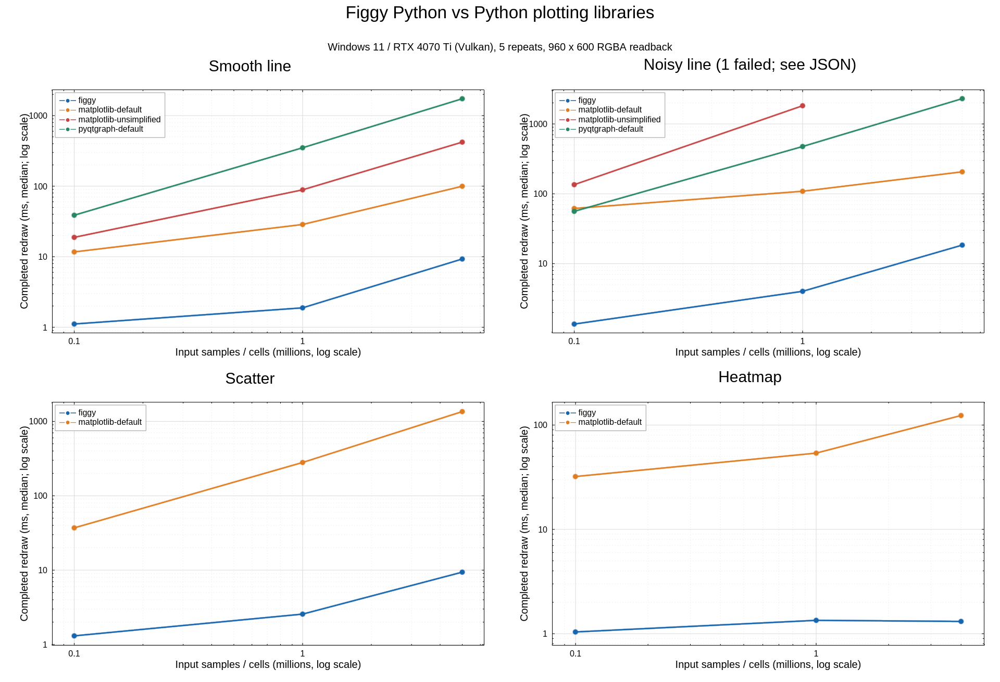

# Windows RTX 4070 Ti benchmarks

See the subsequent [GPU library comparison](WINDOWS_GPU_RESULTS.md) for
fastplotlib, VisPy and pyqtgraph OpenGL. The pyqtgraph rows below use the earlier
QPainter path.

2026-10-14 (Asia/Seoul), measured with an installed Windows release wheel.

## Environment and method

- Source: `ff4bf0cf2d2f8457434abc211c71201e30a09101`. Benchmark code and native
  bindings were unchanged from that revision.
- Windows-11-10.0.26300-SP0; Python 3.13.1; Rust 1.99.0 / MSVC.
- Intel Core i7-13700KF, 16 cores/24 threads, approximately 64 GiB system RAM.
- NVIDIA GeForce RTX 4070 Ti, 12,282 MiB VRAM, driver 617.14.
- Figgy selected **Vulkan / DiscreteGpu** by default. These are not DX12 timings.
- Completed 960×600 RGBA readback, identical float64 inputs, independent
  processes and medians of five repetitions.
- Initialization, registration/fit, first draw, repeated draw, axis/style edits,
  PNG render/encode and worker peak RSS are reported separately.
- Imports/input generation are excluded. OS/font/driver shader caches were not
  reset.
- Figgy keeps all data resident without downsampling. After repeated rendering,
  lines/scatter retain two uploads; heatmaps retain 318/1,002/2,002 uploads for
  row and coordinate columns.
- Comparison includes matplotlib default/disabled simplification and pyqtgraph
  default QPainter: AA off, OpenGL off, autoDownsample off.
- This does not measure GPU surface FPS, Qt-window latency or Jupyter display
  latency. AA methods and output pixels differ between backends.
- RSS includes inputs, libraries and drivers; it is not a VRAM measurement.

## Representative results

| Workload | Figgy repeated (ms) | matplotlib default repeated (ms) | Repeated speed ratio | Figgy first frame (ms) | matplotlib first frame (ms) |
|---|---:|---:|---:|---:|---:|
| 5M smooth line | 9.28 | 99.66 | 10.7× | 462.78 | 290.72 |
| 5M noisy line | 18.44 | 206.36 | 11.2× | 479.91 | 416.62 |
| 5M scatter | 9.40 | 1353.27 | 144.0× | 659.45 | 1481.04 |
| 4M-cell heatmap | 1.31 | 123.39 | 94.1× | 668.28 | 154.53 |

Ratios compare repeated RGBA rendering on this PC only. Initialization/upload,
PNG encoding and UI transfer costs must be considered separately.

`benchmarks/plot_results.py` renders the comparison chart with Figgy. Lines,
markers, axes, legends and titles come from Rust figgy-renderer. Since the Python
API exposes one panel, Pillow arranges the four completed panels and heading
pixels. SVG is a container for that PNG, not vector export. Report generation
is excluded from benchmark timings. The
[rendering record](results/windows-rtx4070ti-comparison.rendering.json) names
each panel's actual adapter.

## All measurements

| Workload | Signal | Samples | Backend | Status | First frame (ms) | Repeated (ms) | Axis edit (ms) | Style edit (ms) | PNG (ms) | Peak RSS (MiB) |
|---|---|---:|---|---|---:|---:|---:|---:|---:|---:|
| line | smooth | 100,000 | figgy | ok | 403.22 | 1.11 | 2.66 | 2.95 | 14.91 | 192.5 |
| line | smooth | 100,000 | matplotlib-default | ok | 32.03 | 11.68 | 11.17 | 11.38 | 26.85 | 76.1 |
| line | smooth | 100,000 | matplotlib-unsimplified | ok | 37.09 | 18.79 | 17.56 | 17.23 | 32.95 | 76.3 |
| line | smooth | 100,000 | pyqtgraph-default | ok | 95.78 | 38.71 | 41.01 | 39.20 | 50.10 | 112.1 |
| line | smooth | 1,000,000 | figgy | ok | 414.79 | 1.88 | 3.47 | 3.71 | 16.59 | 207.1 |
| line | smooth | 1,000,000 | matplotlib-default | ok | 78.51 | 28.61 | 27.81 | 28.13 | 43.46 | 117.2 |
| line | smooth | 1,000,000 | matplotlib-unsimplified | ok | 141.41 | 88.68 | 88.07 | 87.85 | 103.67 | 128.0 |
| line | smooth | 1,000,000 | pyqtgraph-default | ok | 734.77 | 350.13 | 355.78 | 357.83 | 361.77 | 152.9 |
| line | smooth | 5,000,000 | figgy | ok | 462.78 | 9.28 | 10.78 | 10.90 | 24.18 | 267.8 |
| line | smooth | 5,000,000 | matplotlib-default | ok | 290.72 | 99.66 | 97.54 | 98.70 | 111.73 | 385.4 |
| line | smooth | 5,000,000 | matplotlib-unsimplified | ok | 618.38 | 420.79 | 421.03 | 419.74 | 430.68 | 396.8 |
| line | smooth | 5,000,000 | pyqtgraph-default | ok | 3589.82 | 1734.53 | 1747.75 | 1778.60 | 1760.41 | 335.9 |
| line | noisy | 100,000 | figgy | ok | 418.76 | 1.37 | 2.82 | 2.88 | 17.77 | 196.7 |
| line | noisy | 100,000 | matplotlib-default | ok | 92.66 | 61.72 | 65.59 | 64.69 | 79.72 | 117.8 |
| line | noisy | 100,000 | matplotlib-unsimplified | ok | 187.23 | 135.12 | 134.79 | 134.09 | 148.68 | 167.0 |
| line | noisy | 100,000 | pyqtgraph-default | ok | 120.79 | 56.10 | 59.79 | 58.25 | 69.57 | 117.2 |
| line | noisy | 1,000,000 | figgy | ok | 425.86 | 4.02 | 5.52 | 5.76 | 20.86 | 209.2 |
| line | noisy | 1,000,000 | matplotlib-default | ok | 175.67 | 108.77 | 117.17 | 115.93 | 130.39 | 180.1 |
| line | noisy | 1,000,000 | matplotlib-unsimplified | ok | 2100.21 | 1821.58 | 1847.60 | 1838.03 | 1810.03 | 986.0 |
| line | noisy | 1,000,000 | pyqtgraph-default | ok | 962.91 | 475.21 | 478.19 | 484.87 | 491.63 | 158.2 |
| line | noisy | 5,000,000 | figgy | ok | 479.91 | 18.44 | 20.04 | 20.00 | 37.84 | 270.6 |
| line | noisy | 5,000,000 | matplotlib-default | ok | 416.62 | 206.36 | 215.58 | 215.48 | 237.16 | 390.5 |
| line | noisy | 5,000,000 | matplotlib-unsimplified | error | — | — | — | — | — | — |
| line | noisy | 5,000,000 | pyqtgraph-default | ok | 4669.31 | 2301.23 | 2311.56 | 2344.90 | 2317.69 | 341.8 |
| scatter | noisy | 100,000 | figgy | ok | 413.33 | 1.31 | 2.76 | 2.99 | 32.64 | 196.4 |
| scatter | noisy | 100,000 | matplotlib-default | ok | 67.38 | 36.99 | 37.01 | 37.76 | 54.42 | 76.4 |
| scatter | noisy | 1,000,000 | figgy | ok | 439.39 | 2.56 | 4.27 | 4.30 | 37.17 | 210.1 |
| scatter | noisy | 1,000,000 | matplotlib-default | ok | 317.57 | 280.18 | 279.40 | 280.05 | 294.26 | 126.2 |
| scatter | noisy | 5,000,000 | figgy | ok | 659.45 | 9.40 | 11.10 | 11.92 | 46.58 | 270.9 |
| scatter | noisy | 5,000,000 | matplotlib-default | ok | 1481.04 | 1353.27 | 1348.71 | 1345.52 | 1352.15 | 399.0 |
| heatmap | smooth | 99,856 | figgy | ok | 426.76 | 1.04 | 2.96 | — | 23.10 | 200.2 |
| heatmap | smooth | 99,856 | matplotlib-default | ok | 56.84 | 32.09 | 30.53 | — | 50.31 | 103.3 |
| heatmap | smooth | 1,000,000 | figgy | ok | 479.37 | 1.34 | 3.18 | — | 59.24 | 206.5 |
| heatmap | smooth | 1,000,000 | matplotlib-default | ok | 79.73 | 53.80 | 52.06 | — | 85.96 | 151.4 |
| heatmap | smooth | 4,000,000 | figgy | ok | 668.28 | 1.31 | 3.25 | — | 59.03 | 235.2 |
| heatmap | smooth | 4,000,000 | matplotlib-default | ok | 154.53 | 123.39 | 121.03 | — | 152.59 | 385.6 |

Of 36 conditions, 35 succeeded, one errored and none timed out. All Figgy inputs
succeeded. The failed row and original message remain in JSON.

- `matplotlib-unsimplified / line / noisy / 5,000,000` raised
  `OverflowError: Exceeded cell block limit in Agg`. Default matplotlib completed
  the same input.
- Exploratory pyqtgraph AA-on checks are excluded. Partial results were retained
  locally in `results/exploratory-windows-pyqtgraph-aa.json`; they are not a
  complete campaign.

## Installation and functional checks

- Built/installed a CPython 3.13 Windows x64 release wheel with
  `python -m pip install ".[desktop,notebook,benchmark,test]"`.
- Full pytest with Chrome connected: **9 passed, 1 skipped**. The skip targets
  allocation failure on devices at or below 128 MiB; this GPU's column-pool
  limit is approximately 2 GiB.
- A later installed build with logarithmic-axis APIs passed **11 tests, 1
  skipped**, including native log rendering/picking and atomic invalid edits.
- Browser integration passed title edits, selection/drag, Python clipboard
  copying and PNG download.
- The historical QtWebEngine host ran `examples/quickstart.py`, created a PNG,
  displayed a 960×600 canvas and reflected title changes in native state before
  automatic closure. This predates the current winit desktop host.
- anywidget command handling was tested. An actual Windows JupyterLab session
  was outside this run's scope.
- [pytest log](results/windows-rtx4070ti-tests.txt) ·
  [Qt verification](results/windows-rtx4070ti-desktop.json). Local screenshots
  were retained in `results/images/windows-rtx4070ti/`.

## Reproduce

```powershell
$env:RUSTUP_TOOLCHAIN = '1.99.0'
python -m venv .venv
.\.venv\Scripts\python.exe -m pip install ".[desktop,notebook,benchmark,test]"
.\.venv\Scripts\python.exe benchmarks/compare.py --sizes 100000 1000000 5000000 --kinds line --signals smooth noisy --backends figgy matplotlib-default matplotlib-unsimplified pyqtgraph-default --repeats 5 --timeout 120 --output benchmarks/results/windows-rtx4070ti-line.json
.\.venv\Scripts\python.exe benchmarks/compare.py --sizes 100000 1000000 5000000 --kinds scatter --signals noisy --backends figgy matplotlib-default --repeats 5 --timeout 120 --output benchmarks/results/windows-rtx4070ti-scatter.json
.\.venv\Scripts\python.exe benchmarks/compare.py --sizes 100000 1000000 4000000 --kinds heatmap --backends figgy matplotlib-default --repeats 5 --timeout 120 --output benchmarks/results/windows-rtx4070ti-heatmap.json
.\.venv\Scripts\python.exe benchmarks/plot_results.py benchmarks/results/windows-rtx4070ti-line.json benchmarks/results/windows-rtx4070ti-scatter.json benchmarks/results/windows-rtx4070ti-heatmap.json --output benchmarks/results/windows-rtx4070ti-comparison --subtitle "Windows 11 / RTX 4070 Ti (Vulkan), 5 repeats, 960 x 600 RGBA readback"
```

[Line JSON](results/windows-rtx4070ti-line.json) ·
[Scatter JSON](results/windows-rtx4070ti-scatter.json) ·
[Heatmap JSON](results/windows-rtx4070ti-heatmap.json) ·
[Comparison SVG with embedded PNG](results/windows-rtx4070ti-comparison.svg)


