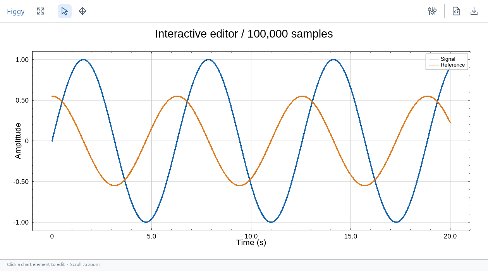
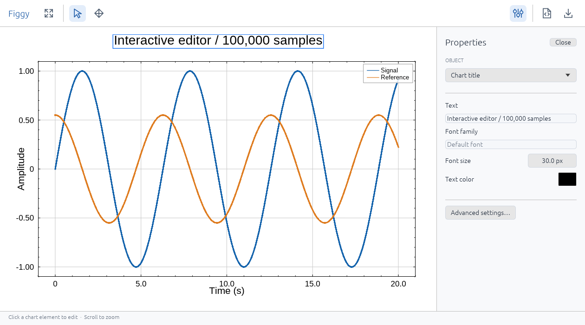
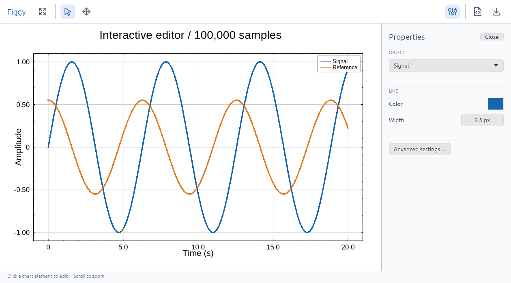

# 데스크톱 창 실행과 편집

현재 데스크톱은 Rust winit + egui + wgpu surface입니다. Qt/PySide6나 브라우저를
띄울 필요가 없습니다. 아래 스크린샷은 실제 Linux X11 창을 소프트웨어 Vulkan GPU에서
캡처한 것입니다. Windows/macOS의 창 테두리와 폰트는 환경에 따라 다를 수 있으며,
그 플랫폼의 새 호스트 실행은 아직 검증하지 않았습니다.

창/이벤트 호스트와 속성 패널은 역할이 다릅니다. **창은 winit**이 만들고,
egui는 그 창 안의 툴바·속성 폼·팝업을 그립니다. winit에는 버튼·입력칸 등의 위젯이 없어서
패널을 위해 egui를 사용했습니다. 별도 egui 창이나 다른 차트 엔진은 없습니다.

| 구성 요소 | 역할 |
|---|---|
| winit | OS 창, 입력 이벤트, main-thread 이벤트 루프 |
| wgpu | GPU surface, 명령 제출·표시 |
| figgy-renderer | 차트·설정·렌더링·피킹·드래그 정책 |
| egui | 툴바·속성 패널·팝업의 입력칸·버튼·색상 선택기 |

## 바로 실행

이미 저장소와 가상환경이 있다면, 활성화된 가상환경에서:

```bash
cd figgy-python
git pull
python -m pip install .
python examples/desktop_editor.py
```

처음 설치하는 Windows PowerShell 예시:

```powershell
git clone https://github.com/shim9610/figgy-python.git
cd figgy-python
python -m venv .venv
.\.venv\Scripts\Activate.ps1
python -m pip install --upgrade pip
python -m pip install .
python examples/desktop_editor.py
```

소스 설치에는 Rust 1.99 이상이 필요하며 Windows는 MSVC C++ Build Tools,
macOS는 Xcode Command Line Tools, Linux는 시스템 컴파일러/링커가 필요합니다.
PyPI에는 아직 게시하지 않았습니다. 호환 wheel 설치에는 Rust가 필요 없지만 현재
확인한 wheel은 Linux x86_64 / CPython 3.12용입니다. 자동 CI는 안정화 중 꺼둔 상태입니다.

직접 작성할 때의 최소 코드:

```python
import numpy as np
import figgy

x = np.linspace(0, 20, 100_000, dtype=np.float32)
fig, ax = figgy.subplots(backend="native")
ax.plot(x, np.sin(x), label="Signal", id="signal")
ax.set_title("Interactive chart", fontsize=18)
ax.set_xlabel("Time (s)")
ax.set_ylabel("Amplitude")
ax.legend()
try:
    fig.show()
finally:
    fig.close()
```

`backend="native"`를 명시하면 IPython/Jupyter에서도 backend 자동 선택과 혼동하지
않습니다. 다만 창은 **커널이 실행되는 머신의 데스크톱**에 뜹니다. 원격 커널에서 내
브라우저 안에 표시하려면 `backend="webgpu"`와 `display(fig)`를 사용합니다.

## UI와 조작

기본 화면은 차트와 상단 툴바입니다. 속성 패널은 닫혀 있으며, 차트의 제목·축·범례·
데이터 시리즈를 클릭하면 오른쪽에 해당 객체의 편집 폼이 열립니다. **Properties**로
직접 열고 닫을 수도 있습니다. 툴바는 벡터 아이콘으로 그리며, 기능 이름은 마우스를
올리면 툴팁으로 표시됩니다. 패널을 열거나 창 크기를 바꾸면 차트 미리보기가 남은
공간에 맞게 배치됩니다. 문서의 PNG 출력 크기는 바뀌지 않습니다.



| 툴바/선택 대상 | 기능 |
|---|---|
| 네 모서리 화살표 · Fit view | 현재 데이터에 맞게 축 범위 조정 |
| 포인터 · Select | 데이터/장식 객체 선택. 기본 모드 |
| 십자 화살표 · Layout | 플롯 영역의 이동·크기 조정 허용 |
| 슬라이더 · Properties / 패널의 Close | 속성 패널 열기·닫기 |
| 객체 드롭다운 | Chart title, X axis, Signal 등 이름으로 선택 |
| 제목·축 제목·범례 | 텍스트, 폰트 family 이름, 글씨 크기, 색 |
| 눈금 글씨 | 폰트 family 이름, 크기, 색 |
| 데이터 선 | 색, 두께 |
| 산점도 | 색, 점 크기 |
| 히트맵 시리즈 | 색 범위 최소/최대, Viridis/Magma/Turbo/GrayScale/RdBu 컬러맵 |
| 축 | 최소/최대, 눈금 간격, 선 두께·색 |
| 코드 문서 · Copy Python | 현재 SSOT 설정을 `fig.apply_settings(...)` 코드로 클립보드에 복사 |
| 다운로드 · Save PNG | 경로 입력 팝업 → Save image. 차트만 문서 해상도로 저장 |
| Advanced settings… | 전체 설정 JSON 창 → Apply settings. 추가 renderer 속성 편집 |

제목·축 제목·범례 등은 직접 드래그할 수 있습니다. 모든 객체가 이동·크기 조정을
지원하는 것은 아니며 renderer의 핸들/정책을 따릅니다. 데이터 시리즈 선택은 스타일
편집용이며, 데이터 점을 움직여 원본 값을 수정하는 기능은 없습니다. 휠 줌은 linear
축 범위 중심을 기준으로 하며 커서 위치를 기준으로 하지 않습니다.

텍스트·숫자·색 입력 변경은 즉시 Figure 설정에 반영됩니다. 숫자는 드래그하거나
더블클릭해 입력할 수 있습니다. 고급 JSON은 Apply settings로 적용합니다. 오류는
창 아래 상태 줄에 표시됩니다. PNG 경로는 상대 경로일 경우 실행 디렉터리 기준이며,
같은 파일은 덮어씁니다. 상위 디렉터리는 먼저 만들어 두세요.

제목을 클릭하면 텍스트·폰트·크기·색만 표시됩니다:



데이터 선을 클릭하면 해당 시리즈의 색·두께가 표시됩니다. 선택된 데이터는 차트에
강조되며 원본 배열을 재업로드하지 않습니다:



## 주요 제약

- `show()`와 창 이벤트 처리는 Python **main thread**에서 실행해야 합니다.
  기본 `show()`는 현재 열린 모든 Figgy 창이 닫힐 때까지 반환하지 않습니다.
- `show(block=False)`는 이벤트 루프를 자동으로 백그라운드에서 실행하지 않습니다.
  main thread에서 `poll_events()`를 계속 호출하거나 `run_events()`를 실행해야 합니다.
  Qt/Tk 루프나 `%gui qt` 자동 통합은 없습니다.
- 현재 Figure당 Axes 1개입니다. `subplots(2, 2)` 같은 다중 패널은 미지원입니다.
  `fig.show()`를 다시 호출하면 새 창을 만들며, 같은 Figure의 데이터를 공유합니다.
- `font`는 로컬에 설치된 family 이름입니다. 없는 family는 renderer 기본 폰트로
  대체됩니다. 파일 경로/폰트 업로드 UI는 없습니다. 한글은 해당 글리프를 지원하는
  설치 폰트를 사용해야 합니다. 예: Windows의 `Malgun Gothic`.
- 패널의 Font size, 선 두께 등은 renderer의 문서 단위입니다. Python의
  `fontsize`/`linewidth`는 pt → `dpi / 72`로 변환합니다. 예: dpi=120에서
  `fontsize=18`은 패널에 30으로 표시됩니다.
- 히트맵 폼은 문서의 공유 colorbar 범위를 편집합니다. 시리즈별 독립 colorbar UI나
  사용자 정의 컬러맵 편집기는 없으며 고급 JSON 또는 Python API를 사용합니다.
- Copy Python은 배열을 포함하지 않습니다. 같은 순서의 시리즈 ID와 데이터 열 연결을
  가진 Figure를 만든 뒤 복사한 설정을 적용합니다. 실시간 편집은 Figure 설정에 반영됩니다.
- 최초 GPU 초기화와 새 파이프라인 준비에 지연이 생길 수 있습니다. `fig.prepare()`는
  선택 사항이며, 설치 시 셰이더 컴파일 완료나 영속 캐시를 보장하지 않습니다.
- native Figures는 전역 GPU 장치·renderer·column pool을 공유합니다. 총 데이터가
  adapter의 한 storage buffer 한도를 넘으면 `MemoryError`가 납니다. 자동 다운샘플링,
  스트리밍 전환이나 활성 데이터 폐기는 없습니다.
- 창만 닫으면 Figure 데이터는 유지합니다. `fig.close()`는 해당 데이터 소유권을
  반납하고, 모든 native Figure를 닫은 뒤 `figgy.release_gpu()`로 공유 자원까지 해제합니다.
- Windows/macOS 하드웨어, Wayland, 실제 모니터 간 DPI 이동은 아직 여기서 실행
  검증하지 않았습니다. 스크린샷의 X11 소프트웨어 GPU 동작과 구분해야 합니다.

비차단 창을 사용하려면:

```python
from figgy.desktop import poll_events, run_events
window = fig.show(block=False)
run_events()  # main thread에서 모든 현재 창이 닫힐 때까지 처리
# 외부 main-thread 루프에 통합한다면 반복해서 poll_events() 호출
```

Jupyter의 브라우저 편집은 [호스트 문서](HOSTS.md), native 공유 자원 수명은
[전역 공유 문서](NATIVE_SHARING.md)를 참고하세요.

무작위 입력·오류 복구·대기 원인과 검증 범위는 [무작위 검증 보고서](RANDOMIZED_VALIDATION.md)를 참고하세요.
