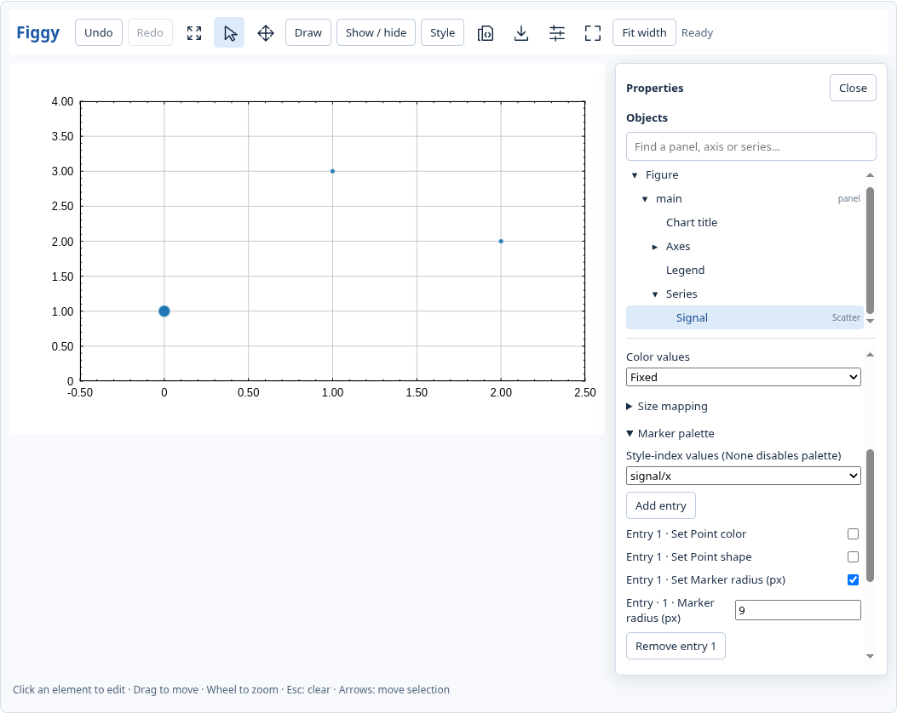

# Editor commands and history

The native window and live WebGPU notebook inspector derive contextual controls
from the accepted settings document. Object selection uses the chart or object
tree; a property command addresses its stable object key, rather than the
position of that object in a menu. Python can inspect and execute the same commands:

```python
owner = fig.editor_properties("series/signal")
fig.edit_property(owner["id"], "Line/line_width", 4,
                  expected_revision=fig.revision)
fig.undo()
fig.redo()
```

`editor_properties()` lists all objects; passing an object ID describes only
that object. A field describes its property ID, current value, input kind and
available choices. A collection action is activated with `value=True`.
Ordinary commands resolve the object and property again against the current
document. An invalid choice, removed object, stale revision or failed renderer
validation preserves the accepted document and its history.

The source arrays stay resident. Mapping controls choose registered columns;
they do not infer numbers from rendered colors or upload replacement data.
The panel colorbar owns the colormap and value domain. Explicit point-color
overrides take precedence, and fixed RGB series remain independent of a
standalone colorbar. The inspector reports that distinction.

The [upstream resolution order](https://github.com/shim9610/figgy/blob/3a0a6a33be14f2ff4dab1475d4fcec9eafa1ee04/crates/renderer/src/data_render/scatter_columnar.wgsl#L707)
is **point override > value map > palette entry > series default**. Palette
entries and sparse point overrides start with inherited properties; enabling
only a size override does not silently create a color override. The controls
distinguish palette values from point overrides and explain active mapping.

Run [the manual example](../examples/editor_commands.py) against the current
checkout's wheel to try named panels, mapped points, annotations and history.



## Editing history

Undo and Redo work on persistent settings. Pointer selection, hover, focus and
the active interaction layer are not undoable chart edits. A continuous native
drag, browser drag or committed text session forms one operation. Undo/Redo
replays an accepted document through validation and advances the revision;
revision numbers never run backwards. A divergent edit clears Redo.

`fig.edit_history` reports availability, labels, counts, an active gesture and whether it contains
an accepted pending edit. Closing a native window finishes that operation, so
Python Undo remains available after the window closes.
`fig.edit_operations()` reports retained operations, revisions and actual SSOT
changes with JSON Pointer paths and stable owner identities. Missing values
are distinguished from JSON `null` by `before_exists` and `after_exists`.
This journal describes accepted state; it does not predict a layout result.

Reset edits restores the first presentation of the chart in a native window
or live notebook widget. It is itself undoable. For a headless workflow, the
default baseline is the start of the first edit after source construction.
`fig.mark_edit_baseline()` explicitly chooses the current document instead,
without discarding Undo/Redo. Reopening another view of the same Figure does
not silently replace the baseline.

History retains at most 128 operations and 8 MiB of serialized before/after
settings, excluding the reset baseline and source arrays. Older entries expire;
an edit larger than the journal budget clears Undo rather than retaining an
unreplayable chain. Adding source series starts a new history epoch, because a
settings replay cannot resurrect replaced source buffers. Failed construction
does not discard the previous history.

Object deletions retire their IDs in the validated host boundary. Ordinary
settings replacement cannot reuse a retired ID. Explicit Undo/Redo/Reset may
restore the accepted historical object. Selection follows an annotation's ID
when its order changes.

## Contextual controls

| Selected object | Controls | Python command groups |
| --- | --- | --- |
| Figure | Named grid slot assignment, gaps and row/column weights; Reset | `Figure grid/*`, `reset_edits()` |
| Plot area | Numeric geometry, shared X/Y membership, grid, polar settings | `Panel geometry/*`, `Shared axes/*`, `Grid/*`, `Polar coordinates/*` |
| Line / scatter-line | Width, dash, interpolation, color, baseline/reference fill | `Line/*`, `Area fill/*` |
| Markers | Shape, radius, color; scalar color/size bindings and domains | `Markers/*`, `Color mapping/*`, `Size mapping/*` |
| Marker/error palettes | Add/remove entries, style-index source, per-entry appearance | `Marker palette/*`, `Error-bar palette/*` |
| Point overrides | Add/remove sparse index overrides and edit their appearance | `Marker point overrides/*`, `Error-bar point overrides/*` |
| Histogram / error bars | Bar dimensions, baseline, orientation, error stem/caps | `Bars/*`, `Error bars/*` |
| Contour | Explicit levels, strokes, per-level colors, labels | `Contours/*`, `Contour labels/*`, `Label positions/*` |
| Vector | Pivot, head/shaft dimensions, pixel/data length units and factor | `Vectors/*`, `Color mapping/*` for point vectors |
| Colorbar or mapped series | Colormap, scale/domain, layout, tick/label appearance | `Color scale/*`, `Colorbar layout/*`, `Colorbar ticks and labels/*` |
| Colorbar title / tick labels | Direct title text with retained character styles; focused typography and numeric label formatting | `Title/*`, `Tick labels/*` |
| Bounded chart | Material, geometry, labels, chart options, pie/donut shape | `Chart style/*`, `Chart options/*`, `Pie / donut/*` |
| Annotation | Rich text first, coordinates, endpoints/edges, stroke, opacity, order/delete | `Coordinates/*`, `Annotation/*`; direct manipulation and text form |

[The generated field inventory](EDITOR_CONTROLS.csv) lists the property and
SSOT pointer for each materialised fixture, with the adapter and command path.
It records exposure, with representative behavioral coverage by group; it does
not claim an individual screenshot assertion for every row. Regenerate it with
`python scripts/editor_control_inventory.py` after installing the current wheel.
`--check` rejects an undocumented catalog change. Specialized forms own fields
they already expose, so the supplemental catalog does not duplicate them.

Grid vectors can use their resident horizontal/vertical component grids or
retain their explicit color grid. Their scalar domains come from recorded
column extents. Renderer 0.18.1 adds grid-vector arrow picking; its selection outline covers
the whole cell. The object tree also exposes these controls. Numeric label formats include degrees/radians and
timestamp units, offsets, patterns, fractional digits and tick policy.

Shared-axis commands adopt the chosen target's range, scale and tick intent.
Labels and visual styles remain local. Detaching a chart retains its current
range and reconnects the remaining group, including when the former owner is
detached. Assigning an occupied named grid slot swaps the two charts without
changing their IDs. Manually changing a panel rectangle leaves named-grid
layout, so later grid reflow cannot overwrite a free placement accidentally.

Annotation Data/Ratio conversion uses upstream anchor transforms. Ratio Y
increases downwards from the top of the plot. Cartesian, categorical and box
plots offer Data anchors; pie/donut, radar and polar annotations use Ratio.
Spans remain in the renderer's behind-data pass; order does not change their
rendering pass. An impossible conversion fails without changing coordinates.

Rich text editing, typography, axis ticks/ranges, legend text, visibility,
direct annotation drawing/handles and overlap selection retain their existing
specialized forms. The shared catalog supplements those forms. Advanced JSON
remains an escape hatch. The explicit PNG fallback editor retains its limited
control set; it has history commands but is not the live WebGPU inspector.

Bounded series support independent styles and a return to inheritance.
Categorical/boxplot selections can override the individual item. Boxplot
summary fields are numeric controls; ordering validation still applies.
Split radial charts expose a separate Detail slices tree group and detail pie/donut
shape controls. Selecting a detail slice edits that slice rather than its parent.
Radial slice addresses use the upstream group/index because its slice model
has no ID field. They survive presentation edits; refresh the catalog after
structural data replacement and submit the expected revision when editing.

## Transport and verification

The browser receives common resident-column choices once and references them
from field descriptions. The native inspector builds descriptions for its
selected object only. The public full catalog is an explicit introspection
operation, not a per-frame rendering requirement.
See the [catalog measurement record](EDITOR_CATALOG_MEASUREMENTS.md) for the
reproducible transport-size and metadata-cost measurements.

`test_edit_history.py` checks accepted document restoration, revisions, rejected
edits, journal branches, identity retirement and reset baselines on both host
models. `test_editor_properties.py` checks real command effects and code replay.
The interaction parity suite uses actual X11 and notebook input, compares
prepared annotation rectangles for coordinate conversion, and checks real
Undo/Redo and Reset buttons. Source-upload counters detect accidental data
replacement. Pixel checks verify colorbar and mapped-data changes together.

Automatic layout can depend on its prior state. An arbitrary sequence returning
one input value to its original value is not an Undo contract. Layout tests must
dump and compare the complete accepted SSOT and the actual prepared geometry;
they must not assume that gesture deltas imply an identical document.

Widget state travels asynchronously from Python to the browser. `await fig.sync()`
acknowledges accepted edits before a cross-host assertion; kernel idle or a local
browser queue flush alone does not acknowledge a newly sent Python command.
Annotation hit geometry is prepared from current renderer state independently of
display-GPU completion. The [held-GPU probe](measurements/cartesian-pending-gpu-geometry-20261021.json)
moves a Cartesian annotation while a display fence is pending and verifies the
updated rectangle without another submission or source-column upload. Its
negative control retains the stale rectangle on commit `9542f9a`.

The [0.18.1 local run record](measurements/local-0181-suite-20261021.json)
reconciles all 593 collected tests across resumed runs, including the corrected
tick-baseline test, with no missing or skipped cases. It records the initial
failure and does not claim one uninterrupted pass or a Chromium 156 CI result.
The summed final case times are about 39 minutes. CI builds the wheel in a
separate job and verifies its checksum before the existing integration checks,
preserving the 45-minute test job and all individual assertions and deadlines.

The LLM review mode, separate review comments and binary recovery checkpoints
remain a separate workflow. These controls and history need no LLM session.
