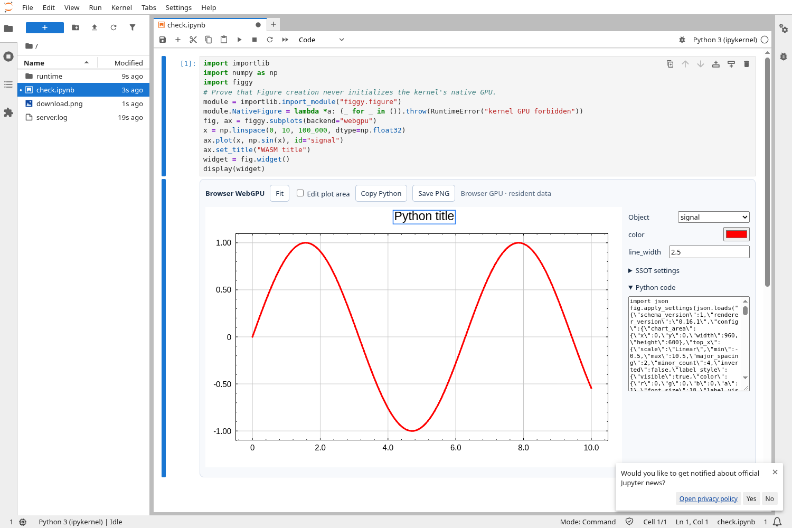

# 0.2 host verification

2026-10-14 (Asia/Seoul), based on main `294b270a2b2e6645056278b3ef035e5199a5f658`.

## Environment

- Linux x86_64, glibc 2.41, CPU quota 4 cores; no physical GPU available.
- Rust 1.99.0, CPython 3.12.14.
- Native: Vulkan **llvmpipe LLVM 19.1.7**, Xvfb X11 display.
- Browser: Chromium 154, software **SwiftShader Vulkan**, a headed browser on Xvfb.
- JupyterLab 4.6.4 + anywidget 0.11.0.

These are software GPU checks, not Windows RTX 4070 Ti or macOS hardware checks.
The earlier Windows results in `benchmarks/WINDOWS_GPU_RESULTS.md` measure the old
completed RGBA path; they do not validate the new hosts or predict their UI FPS.

## Installed package checks

Built `figgy_python-0.2.0-cp312-cp312-manylinux_2_39_x86_64.whl`, installed it with
`[notebook]` into a separate virtual environment, and ran the tests against that
installed package. No PySide6/QtWebEngine was installed in that environment.
The local wheel requires **glibc 2.39+**. Other Python/OS wheel builds are CI
configuration, not successful execution claims in this record.

Native extension import, WebGPU JS, WASM magic, and asset SHA-256 against
`assets/provenance.json` were checked. The wheel contains the local assets,
font notices and native hosts. Source distribution includes native source and
prebuilt WASM, so ordinary source installation does not build the browser kernel.
`cargo fmt --check`, release/locked wheel build and strict twine checks passed.

## Functional checks

The installed-wheel suite passes **17 tests**, including the original native and
explicit PNG editor tests, GPU-free notebook model/transfer policy checks, concurrent PyO3 core/GIL calls, the
X11 surface test, and the real JupyterLab/WebGPU test.

Desktop checks exercised an actual presented surface, title selection/drag and
text editing, Copy Python clipboard/replay, panel Save PNG, Python PNG export,
resize to 1350×680, close/reopen, and two independent Figures in one event loop.
Normal edit/drag frames reported **2 initial column uploads, 0 RGBA readbacks,
0 PNG encodes**. Reopening preserved the same 2 uploads. Explicit PNG operations
alone increased readback/encode counters.

A separate process with `WINIT_X11_SCALE_FACTOR=1.5` produced a 1905×900 physical
surface from a 1270×600 logical window while keeping the 960×600 document intact.
This checks forced DPI scaling; physical multi-monitor DPI transitions are not
verified.

The JupyterLab test forbids native GPU Figure construction in its kernel and
still displays the chart. It registers two float32 columns of 100,000 samples:
**800,000 binary bytes, 2 browser uploads**. It checks title edit/drag, red series
style, GPU picking, copied Python replay, `await fig.sync()`, browser download,
`await fig.savefig_async(...)`, and Python → browser title synchronization.
An actual composited canvas screenshot must contain the edited red data pixels;
valid JSON/settings or successful PNG export alone do not count as display proof.
External HTTPS asset requests are blocked during the test. Browser/kernel PNGs
are each 960×600. There are no uncaught browser errors.

Ordinary redraw/drag/style changes report **0 PNG exports**, with columns still
uploaded only twice. The two explicit save operations produce 2 PNG exports.
Browser snapshot buffers and widget binary traits are cleared after ready ack.
WASM async operations and redraw are serialized to avoid mutable-borrow overlap
while picking/exporting. Client tokens and revisions distinguish view edits.

## Software browser limitation found during verification

Chromium's headless Vulkan/software configuration could execute renderer exports
and settings operations while capturing a black canvas. A minimal standalone
WebGPU clear reproduces the software presentation issue independently of Figgy.
Verification therefore uses a **headed Chromium on Xvfb with SwiftShader** and
asserts displayed pixels. llvmpipe remains the native test adapter. This is not a
production automatic fallback or a claim that headless/hardware combinations all
work; verify the browser/driver actually used by the user.

## Submission measurement

`benchmarks/results/linux-software-surface.json` records a 100,000-point native
surface run: 60 measured submissions in 3.399 s, **17.65 submitted frames/s**, with
0 RGBA readbacks/PNG encodes. It includes CPU raster/host preparation, queue
submission and software surface presentation scheduling. It is not completed GPU
readback, physical monitor refresh rate, or hardware performance.

`last_input_to_submit_ms` starts at the Rust chart input callback and ends at CPU
submission. Browser timing starts at its input handler and ends at `frame()`
submission. Neither metric measures physical display/input latency.

## Reproduce

```bash
python -m pip install maturin ".[test]" playwright jupyterlab
maturin build --release --locked --out dist
# Install the compatible wheel in a fresh venv, then:
python -m pytest -q tests/test_figure.py tests/test_notebook_model.py
# Xvfb + xdotool + xclip + software Vulkan must be available:
xvfb-run -a python -m pytest -q tests/test_desktop_host.py
# Run real notebook verification in a display-enabled environment:
FIGGY_TEST_JUPYTER=1 FIGGY_TEST_HEADFUL=1 \
  FIGGY_BROWSER_VK_DRIVER=/usr/lib/chromium/vk_swiftshader_icd.json \
  python -m pytest -q tests/test_jupyter_webgpu.py
```

`FIGGY_BROWSER_VK_DRIVER` selects only the verification browser's Vulkan driver;
the production Python wrapper does not set it. `BROWSER_EXECUTABLE_PATH` can
select Chromium. Headed mode requires a working `DISPLAY`/Xvfb. Test screenshots
and raw browser metrics are emitted into pytest's temporary directory.

## Remaining platform work

Windows hardware surface/input/DPI, macOS Metal/event-loop behavior, Wayland,
physical monitor latency and wheel execution on other Python versions were not
run here. Native blocking/nonblocking calls require main-thread event pumping;
there is no automatic foreign GUI-loop integration. A browser view must be
connected for asynchronous exports. Default released notebook snapshots require
reexecuting the Figure cell after reload, or opting into retained snapshots.
PyPI publication is not part of this change.

## Explicit preparation follow-up

The preparation update was built and installed into the same separate wheel
environment. The full suite passed **20 tests**, including native repeated
`prepare()`, GPU-free manual widget request/error handling, and both automatic
and deferred initialization in real JupyterLab. Additional deferred-view closure
and pre-initialization input checks were verified with the installed wheel.

Native CLI preparation completed 82 observed start/finish events in approximately
**1.03 seconds** on llvmpipe. This measures the preparation call plus current
document RGBA execution after constructor initialization; it is not hardware
startup performance or proof of cross-process cache restoration. Native prepare
preserves settings/revision and 2 resident column uploads, adds one completed
RGBA readback per call, and performs 0 PNG encodes.

The manual notebook test observes **0 browser adapter requests** before
`await fig.prepare_async()`. After preparation it displays and edits the real
canvas, with 800,000 initial binary bytes / 2 uploads / 0 PNG exports before
explicit saves. Preparation returns stages and elapsed time. Browser transfer
snapshots are released on ready; creating/discarding an unprepared additional
view does not request an adapter. Automatic mode remains covered separately.

The wheel includes `figgy.prepare`, both preparation APIs, and local JS/WASM.
The sdist includes `docs/PREPARATION.md`; strict twine checks pass. Automatic CI
remains paused (`workflow_dispatch` only).

**No persistent shader cache was saved or restored.** Renderer 0.16.1 exposes
prewarming but no public pipeline-cache injection. Reports explicitly return
`persistent_cache_supported=False`. See `PREPARATION.md` for this boundary and
remaining target-format/first-use costs. Windows/macOS hardware preparation was
not executed.

## Native global sharing follow-up

All native Figures now share one device, renderer and resident pool. The installed
wheel suite passes **25 tests**. Checks cover same-id line/heatmap isolation,
selection identities and scaled PNG/SSOT replay, close/GC cleanup, sequential
context and prewarm reuse, explicit release refusal/reset, four concurrent Figure
constructors/renderers, and a second Figure's failure halfway through upload
without modifying the first Figure's pixels/settings or leaving orphan columns.

The X11 test opens two independent Figures with the same `signal` id, verifies
their common context id, forces pool growth while the first surface remains
alive, and closes one Figure while the other keeps rendering. The original
selection/drag/text/resize/reopen/clipboard/PNG assertions remain. Normal surface
edits still perform no RGBA readback/PNG encoding. The font family input is edited
through real X11 input and its SSOT is checked. Native tests compare actual pixels
after size/color changes and after switching to an installed DejaVu Serif family,
then replay those settings on a second shared Figure.

Real JupyterLab automatic/manual preparation tests continue to pass after adding
font-family inputs. Browser GPU ownership and the binary transfer policy are
unchanged; these tests do not claim native/browser memory sharing.

`benchmarks/results/linux-software-shared-context.json` records eight Figures,
each with two 100,000-value float32 columns, in one context. The first constructor
took **88.46 ms** and the median of seven subsequent constructors was **0.30 ms**.
The shared pool used **12,800,000 bytes** with 16 MiB capacity; 16 independent column
uploads occurred. Prewarm emitted 80 stage events initially and 2 subsequently,
showing installed groups were reused. Preparation timings include current-chart
execution/readback and cannot be interpreted as shader compilation alone.

These are single-run **llvmpipe software-GPU** observations with the existing
driver cache/environment, not a cold-driver benchmark, UI FPS, Windows hardware
result or guaranteed acceleration factor. Reproduce with
`python benchmarks/shared_context.py --output benchmarks/results/shared-context.json`.
Report charts, when generated, continue to use Figgy.

Release/locked wheel/sdist builds and strict twine metadata checks passed. All
shared resources remain native-process local. Windows/macOS hardware behavior,
different surface formats and physical VRAM pressure remain unverified here.
Automatic CI is still disabled; pipeline disk-cache persistence remains absent.

## Contextual desktop editor, vector toolbar and repaint scheduling

`examples/desktop_editor.py` opens a real native surface with two 100,000-sample
signals. `docs/DESKTOP_EDITOR.md` contains X11 captures for the initial chart-centered
view, title/font editing and GPU-selected series editing. The toolbar glyphs are
vector strokes on the native surface with hover/selected backgrounds and tooltips.
These are screenshots of the presented window, not chart PNG exports or mockups. Capture sessions report 4 initial column
uploads and 0 renderer RGBA readbacks/PNG encodes during interaction.

Screenshot inspection exposed an egui popup sizing pass that requested another
frame without a new OS input event. The winit host now schedules egui viewport
repaint deadlines, including delayed caret updates. The installed-wheel native
surface regression checks that popup pixels appear without forcing refresh or
moving the mouse again; drag, font name/size editing, resize, zoom/fit, Copy Python, saves,
reopen and shared-Figure behavior continue to pass. The inspector starts closed,
opens after a chart selection, and reflows the available preview when toggled.
Export-popup interaction does not reopen a closed inspector or zoom the chart
under the popup. UI and Python PNG exports have identical pixels at the original
960×600 document size after preview resize and editing. A separate native
heatmap UI test edits bounds and a colormap and checks Python settings/to_code()
without readback, PNG encoding or column reuploads. The example's blocking
`show()` opens a window, handles a normal X11 `WM_DELETE_WINDOW` request and exits
successfully. Wheel/sdist builds and strict twine checks pass. These remain Linux
software-GPU checks, not Windows/macOS hardware screenshots.

The final installed-wheel suite passes **26 tests**, including actual headed
Chromium/JupyterLab WASM/WebGPU tests (SwiftShader browser GPU, llvmpipe native
GPU). Installed JS/CSS/WASM files and native extension loading were checked;
the sdist contains the native editor source, example and screenshots.
A separate X11 run with `WINIT_X11_SCALE_FACTOR=1.25` verifies physical icon bounds,
chart selection, inspector opening and resize with no PNG/readback or reupload.
This is a forced scale-factor check, not a physical monitor/DPI transition test.



## Native editor review follow-up (2026-10-14)

The editor review fixes preserve the fitted document aspect ratio and expand a
normal window horizontally for the inspector. Closing the inspector restores
the previous chart space. Maximized/fullscreen windows show the inspector as an
overlay. Toolbar/status controls remain outside the overlay. Advanced JSON now
opens in a separate native OS window on the same renderer context; invalid
edits preserve the document and leave both windows usable.

Legend labels are edited as separate entries, preserving their renderer marks
and separators. Title, legend, axis-title and tick/axis visibility controls can
restore hidden objects through the object list. The color picker reserves its
SV marker radius between the square, hue bar and popup boundary.

Native data selection supports Esc, empty-space clicks and repeated-hit toggles.
Left/right step point indices, up/down choose another point series, and matrix
arrows step cells in the displayed axis directions. Selected decorations can be
nudged with arrows. The inspector shows the selected index, X/Y and matrix
value by reading only those hi/lo samples from GPU storage. No full source
array is retained on CPU; `selection_value_readbacks` is separate from RGBA and
PNG counters. F11 toggles fullscreen.

An installed release wheel passed **42 tests, 3 skipped** on a separate X11
screen with Openbox and llvmpipe (32.26 s). Actual mouse/key tests cover inspector
open/close dimensions, constant aspect ratio, data selection/navigation/clear,
visibility restoration, individual legend labels, the black color-picker marker,
separate settings window identity and atomic rejection/recovery, maximized and
fullscreen overlays, copy/replay, resize/reopen and identical UI/Python PNGs.
Screenshots were inspected. The three skips are the optional Playwright editor
and two opt-in Jupyter/WebGPU tests; browser verification was not rerun here.

The two selected-value tests also pass on the real Radeon 8060S/RADV adapter
(0.14 s), including source-array mutation, float64 hi/lo reconstruction, bounded
point/series/cell navigation and zero RGBA/PNG work. UI automation uses software
Vulkan because this isolated X11 screen has no DRI3 hardware presentation.
The user's review window runs separately on native Wayland/Radeon Vulkan.

A follow-up visibility review adds an always-available **Show / hide** toolbar
menu. It restores chart titles, legends and axis titles without a selected
object or open inspector. The native input test explicitly hides the title,
clears selection, closes the inspector, and restores it through this menu;
legend and X-axis-title toggles use the same route.

The extended visibility-menu input test passes (22.27 s). A bounded 20-step
native UI mutation run also completes: 5 rejected edits preserve state, 2 valid
edits, 3 resizes and 2 main-window reopenings, with the sentinel Figure unchanged.
The multi-window driver forces a pointer-motion event when returning to a window
and waits for the separate settings window to become ready before editing it.

### Readable Python export and axis navigation (2026-10-14)

Copy Python and `Figure.to_code()` now share a GPU-free exporter. Titles, axis
labels, ranges, scales, grid, legend and common series styles use Python setters;
advanced styling/layout uses readable `Figure.configure()` patches. Font sizes
convert renderer pixels to Python points at the Figure's DPI. Replaying the
user-provided snapshot reproduced its settings exactly in 36 lines, including
custom offsets. Source arrays are preserved. Native clipboard replay and exact
RGBA replay passed. Browser widgets use the same exporter after pending edits
are acknowledged; browser UI integration was not executed in this run.

The installed-wheel full suite passed **56 tests, 3 skipped** (Playwright absent,
two Jupyter integration tests opt-in). Four replay/selection tests also passed
on Radeon 8060S Vulkan. The subsequent axis-mapping correction passed **3 actual
X11 input tests**: Ctrl+wheel zooms X only, Shift+wheel zooms Y only, plain wheel
zooms both, and dragging pans. Zoom-in/out preserve the data coordinate under
the physical pointer, including log and inverted axes; the untouched axis stays
unchanged. Independent windows share the GPU while keeping their documents
separate. English instructions are displayed above the graph. Two revised
review windows were launched on Radeon with the current edits preserved.

### Default margins and public README recording (2026-10-14)

The Python hosts had reduced the renderer's left/bottom axis bands from
110/80 pixels to 65/55 pixels. Restoring the renderer defaults in both native
and notebook configuration separates the Y-axis title from numeric ticks.
A raster regression checks a clear gap after the title and native/notebook
configuration parity. The randomized campaign's valid starting canvas was
increased from 240×200 to 320×240 to fit the default axes and heatmap colorbar.

The installed-wheel full suite passed **57 tests, 3 skipped** in 44.06 s on
isolated X11/llvmpipe. Skips remain the absent Playwright dependency and two
opt-in Jupyter integration tests. The default-layout and Python replay subset
also passed on Radeon 8060S Vulkan.

The README GIF uses the automatic TopRight legend with zero offsets over a
late response peak. Actual input adjusts each axis, increases the left margin,
moves the Y title and moves the legend. Copy Python is pasted byte-for-byte
into the installed VS Code, saved and executed through its integrated terminal.
Three distinct PNGs are opened in three VS Code editor columns. The earlier
recording-only PySide6 code input helper was removed. The final GIF contains
86 frames over 14.48 seconds; captions and a pointer halo are composited over
actual windows. The checked-in clipboard code was replayed on Radeon for
three datasets, with six initial column uploads each and no style reuploads.
The recording's isolated terminal profile uses `figgy-demo $` and an editor
title containing only the active filename; personal usernames, hostnames and
temporary workspace paths are not displayed in those fields.

### Public gallery and documentation (2026-10-14)

Eight runnable Python recipes now generate the README gallery: dense signals,
scatter populations, parametric curves, logarithmic axes, model/measurement
markers, an interpolated signed field, a correlation matrix and a spectrogram.
All eight were rendered with native Radeon 8060S Vulkan and visually inspected.
Every standalone CLI exported a 960×600 PNG. An isolated X11/llvmpipe check
also opened a gallery example with `--show`, closed it through the window manager
and verified successful PNG saving. `scripts/render_gallery.py` reproduces the
images and records source links, dimensions, adapter identity and SHA-256.

The README, desktop guide, randomized validation and Linux/Windows benchmark
reports use English. Translation preserved all benchmark table measurements
and reproduction commands. Local Markdown links, Python code-block syntax,
gallery source/image pairs and image hashes/dimensions were checked. The updated
public GIF was re-recorded with the neutral terminal prompt; exact clipboard
paste, actual terminal execution and three distinct output images passed again.

### Pie/donut and stylized Python bindings (2026-10-14)

Python now exposes `Axes.pie`, `Axes.donut`, `RadialArtist` slice/value edits,
`Figure.set_radial_style`, `configure_radial`, `set_facecolor` and
`set_draw_style`. Pie/donut documents use public upstream `RadialChart` and
`RadialRenderer` on the shared native device. Native windows paint the upstream
frame to a GPU texture within egui; ordinary selection/property edits require
zero column uploads, RGBA readbacks or PNG encodes. Cartesian-axis operations
are rejected for radial Figures rather than silently changing unused settings.

The installed final wheel passed **78 tests, 3 skipped** in 52.09 s on isolated
X11/llvmpipe. This includes actual slice selection/clearing, keyboard navigation
past zero-valued slices, title/material edits, clipboard export, inspector size
preservation, maximized overlay and PNG saving. The material menu was expanded
after its default scroll height obscured lower choices during input validation.
The skips remain absent Playwright and two opt-in Jupyter/WebGPU tests.

The **19 new model/render tests** also passed on Radeon 8060S Vulkan (0.60 s).
They cover pie/donut differences, all eleven material shaders with distinct
pixel hashes, NumPy mutation independence, bounded-data validation, radial
picking/preparation, data-preserving code replay, high-DPI style replay,
backgrounds and atomic rejection. Exported radial styles clear transient
selection/hover and preserve new datasets' values, including zero-valued slices.

Milkyway accepts only Line series: scatter, marker lines and heatmaps are
rejected through public setters, raw settings and subsequent additions. The
native menu disables incompatible modes, and the browser host checks the same
series-kind rule before installation. Constellation requires marker lines.
Unknown draw-style options are explicitly checked because internally tagged
serde enums can conceal ignored fields from `serde_ignored`.

Renderer scratch-cache IDs remain namespaced per Figure. GPU style uniforms
derive their star/sketch pattern salt from stable user series IDs, allowing
identical replay across independent Figures without mixing source data.

The gallery now contains **17 actual Radeon renders**, including pie, ceramic
donut, paper/wood/hatch/pearl, Sketch handwriting, Constellation and line-only
Milkyway. Every variant was reproduced in an independent CLI process with exact
PNG SHA-256 agreement. English Markdown, example links, Python code-block syntax,
manifest hashes/dimensions, Rust formatting and browser JS syntax were checked.
Browser model/transport support for Cartesian styles is included, but actual
browser style pixels were not rerun. Interactive browser radial bindings remain
unexposed; radial windows/PNG export require the native backend.
