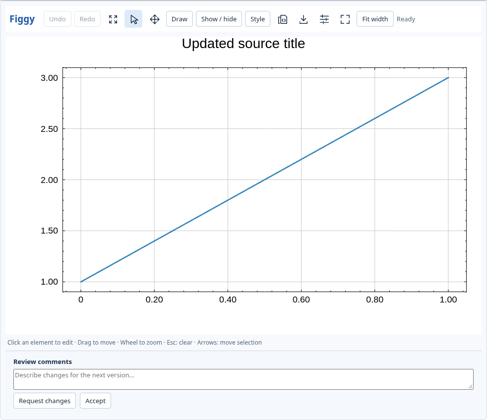
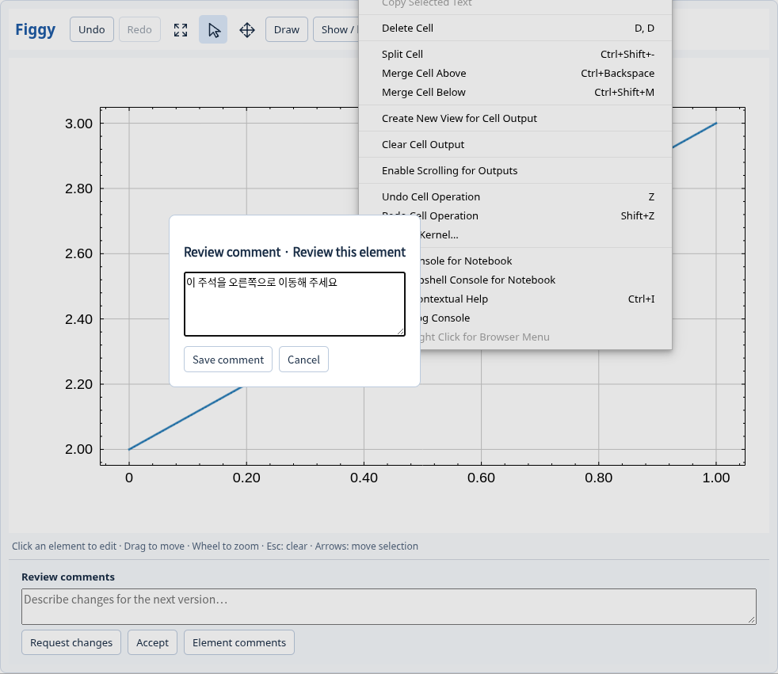

# Review sessions (protocol 1)

Status: unreleased implementation for #18, pending API review. Use a wheel built
from this branch; the previously published figgyplot 0.3.0 does not include it.
See the [validation record](REVIEW_MODE_VALIDATION.md) for measured test coverage.

Issue #18 adds an explicit `figgyplot.review.Session` lifecycle. Ordinary
`Figure`, `show`, notebook editing and Copy Python do not create review files,
start agents or require an LLM runtime.

## API and lifecycle

```python
from figgyplot.review import Session

session = Session(source={"entrypoint": "plots.py", "function": "build", "arguments": {}})
fig = session.figure(id="signal")
fig.axes[0].plot([0, 1], [1, 3], id="measurement")
session.present()  # native windows; use session.widget(fig) in a notebook
session.run_events()  # handles review requests while pumping native windows
```

Native and notebook review panels contain a dedicated **Review comments** input,
**Request changes**, and **Accept**. Chart text/annotations stay chart data.
Approval flushes input, checks the displayed revision, publishes durable feedback,
then closes the approved view. Failed publication keeps the view editable with
the comment intact. Closing a window manually leaves its disposition pending.
`session.submit(figure_id, disposition, comments=..., expected_revision=...)`
is the synchronous native/headless interface; `await session.submit_async(...)`
first acknowledges notebook edits. `skip` is an explicit programmatic disposition.
`session.start()` seals a complete set for headless use without opening views.
`session.comment(figure_id, text, target=...)` appends a targeted API comment.
The editable UI comment has its own channel; changing or clearing it preserves
API comments and their targets. All comment channels are included in feedback.
Runtime revision counters are scoped to recorded Figure instance IDs. Recovery
creates a new instance; baseline and approved instance/revision pairs therefore
remain explicit. Persistent hashes and stable IDs identify the compared states.
The session round number, rather than a process-local Figure counter, drives
successor publication and cleanup.

Figure IDs use the existing document identity namespace. Choose a Figure ID
different from its panel IDs (the default panel is `main`).
Review mode supports one active interactive view per Figure in a round. A second
native window is rejected; duplicate notebook views must be closed before
approval, so another view's pending input cannot be discarded. Native PNG
fallback editors must also be closed before review approval. Ordinary manual
Figures retain their existing multiple-view behavior.

All required Figures form one sealed review set. Only when all have an explicit
disposition can `session.events()` emit the batch's stable work ID and manifest
location. Repeated polling returns the same pending work. Accepting every Figure
without edits/comments finishes the round without requesting code changes.
Source writes belong to one agent/staging workspace, outside the UI event loop.

`Session.open(cache_dir)` resumes a session. `restore(figure_id)` reconstructs a
Figure from the last complete settings and binary payloads. It does not depend
on the original Python process, GPU resources, notebook transfer buffers or an
unbounded undo journal. `cancel()` preserves the last recoverable round.

`regenerate(work_id, superseded=...)` loads the recorded source entry point,
calls its `build(session, **arguments)` function, validates every candidate by
rendering, and publishes a complete new round. Build/render failure preserves
the pending work and previous checkpoint. The source hash must stay unchanged
during validation. Stable Figure IDs must remain present unless explicitly
superseded. Human property changes must be reproduced by source, or explicitly
superseded with a reason. Merely acknowledging an operation is insufficient.
The next complete set is shown only after publication. Agent integration can
use the CLI and filesystem protocol without importing private Python objects.
Source imports, recorded working directory and rendering execute in an isolated
Python worker process, with a configurable timeout. They cannot change the
controller's working directory, module state or UI event loop.

## Feedback and persistence

The versioned session manifest carries session/round/work IDs, source entry point,
function, arguments and digest, per-Figure schema/renderer versions, baseline and
approved revisions, full baseline/approved settings, canonical persistent hashes,
exact edit operations, separately entered comments, and binary references.
Runtime hover/selection is removed using the same Rust projection as edit history.
Operations use JSON Pointer paths, before/after existence and values, and stable
identity selectors. Object creation, removal and ordering are explicit operations;
there is no guessed gesture delta. The baseline and approved snapshots remain
available to interpret derived layout/link changes.

Numeric input is cached at upload time as content-addressed NumPy binary files
(`allow_pickle=False`), with dtype, shape, byte size and SHA-256. Matrix rows and
vector/mapping columns retain their source IDs; bounded-family values reside in
the complete settings document. Settings-only revisions reuse immutable files.
No permanent native CPU array copy or GPU readback is introduced.

Create sessions in a dedicated empty directory, or omit `cache_dir` to allocate
one. `Session.open` requires an existing manifest. Cache creation rejects
nonempty foreign directories before creating files or running cleanup.

Writers and readers hold a process/file lock. Payloads are flushed before a
temporary manifest is flushed and atomically replaced; the directory is flushed
where supported. Only the published manifest defines a complete revision.
Interrupted writes cannot replace the previous complete state. Garbage collection
runs after commits and on reopen/access. It retains the newest complete round,
unfinished work and every referenced baseline/data file. Higher complete rounds
allow reclamation of superseded completed rounds in the same session lineage.
Readers and active writers are protected by the same lock. Cleanup never depends
on an agent acknowledgement or compares unrelated Figure revision counters.

The filesystem adapter is local and agent-neutral. A disconnected agent resumes
through `python -m figgyplot.review subscribe CACHE --timeout 50`; raw arrays never enter the
feedback text. `feedback CACHE WORK` reads structured feedback. Before editing
source, `claim CACHE WORK --worker ID` obtains a renewable writer lease;
`regenerate CACHE WORK --claim-token TOKEN` validates updated source and publishes
its next round. Expired/stale leases cannot publish; duplicate completion returns
the existing successor. `status CACHE` reports pending Figures and rerun errors.
The bundled companion skill documents protocol/version discovery and this loop.
Jupyter controllers use `await session.watch()` to display published successors;
native controllers use `run_events(on_status=...)` to observe progress while
their approved windows are closed.

The [bundled skill](../python/figgyplot/skills/figgyplot-review/SKILL.md) is also
available through `python -m figgyplot.review skill`. Agent hosts use their
existing terminal/tool runner to keep a feedback subscription pending while a human reviews the figures.
The adapter does not require a vendor model SDK. A disconnected agent resumes
the same durable work ID instead of relying on an in-memory notification.

Run adapter commands on the rendering host through the agent's execution tool.
Remote agents need an explicit execution bridge with access to the cache,
recorded source paths and Python environment. A manifest location alone does not
connect a remote chat service. The validation worker needs a native GPU or a
software GPU runtime, including for notebook-built candidates; the notebook
controller itself continues to use its GPU-free document model.

The cache preserves registered renderer columns and canonical bounded values.
For histograms and boxes these include counts/edges or computed statistics;
original samples, external computation inputs and random seeds belong to the
source builder's reproducible inputs/arguments. The checkpoint restores the
chart without inferring those computations from its rendered result.




## Review fonts and element comments

Initialize `Session(..., review_font="Noto Sans CJK KR", review_font_size=14)`
with an installed family that supports the user's primary language. This is
review UI typography, separate from document typography. Native review inputs
load the actual font face; notebook widgets transfer the selected standalone
face to the browser. Unknown families fail at initialization rather than silently
substituting a Latin face. Font metadata survives reopening the cache.

Right-click a chart object or an object-tree row and choose **Add review comment**.
The comment is addressed by its stable object ID and is stored in the `ui_target`
metadata channel. **Element comments** reopens the list for editing/deletion.


General UI comments, targeted UI comments and API comments are preserved
independently; they are never inserted into chart annotations or SSOT.

`Session.open(cache).subscribe(after=last_work_id, timeout=50)` waits for one
complete durable feedback event. Use it from an agent execution process while
the controller continues `run_events()` or `watch()`. The last required Figure's
disposition publishes a requested-change batch and wakes the subscription.
Timeout or session completion returns `None` (`null` from the CLI), not approval.
Check `status`: stop for `completed`/`cancelled`, otherwise resubscribe.
Reconnect using the cache and the last
delivered work ID. Manual `events` lookup remains available. Subscription does
not invoke a model vendor or create an automatic conversation turn on its own;
the waiting execution-tool result delivers the signal to the attached agent.
