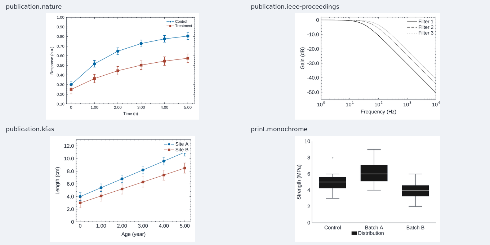
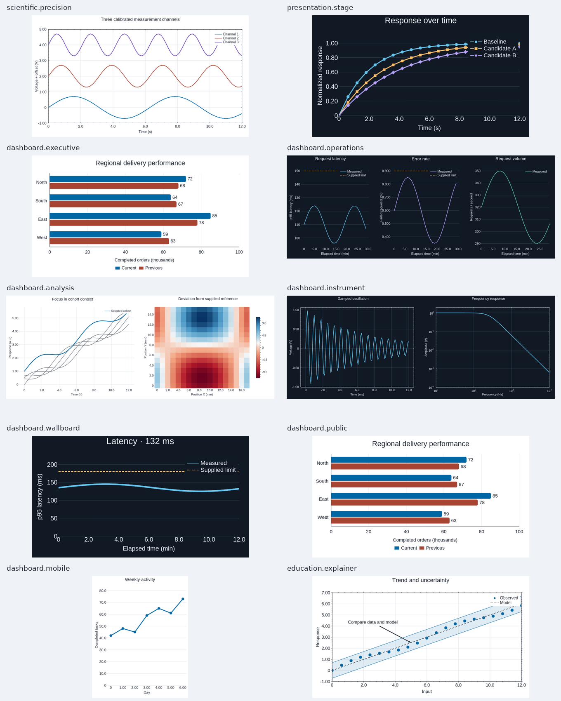

# Task-specific style profiles

Fourteen task profiles supplement the six legacy presets (`paper`, `report`,
`presentation`, `dark`, `monochrome`, `colorblind`). They are editable
`StyleToken` values, available through `styles.available()` and
`styles.preset(name)`. Each combines typography, axes, margins, grids, line and
marker cycles, annotation defaults, bounded-chart appearance and semantic roles.

## Choose by output and task

| Profile | Default | Practical starting point |
| --- | --- | --- |
| `publication.nature` | Light, 6.5 pt | 89/183 mm final-width figures; small error bars and ordinary lettering |
| `publication.ieee-proceedings` | Light, 9 pt, grayscale | Engineering curves with redundant line styles; specifically the Proceedings guidance |
| `publication.kfas` | Light, 9 pt | Four-sided frames and inward ticks; 9 pt is our choice, not a verified journal requirement |
| `scientific.precision` | Light, 10 pt | Full quantitative frame, two-direction major grid and inward ticks |
| `print.monochrome` | Light, 9 pt | Grayscale printing, dash/shape differentiation and contrasting box medians |
| `presentation.stage` | Dark, 17 pt | Large labels and thicker marks for projection |
| `dashboard.executive` | Light, 12 pt | Sparse overview, restrained grid, title hierarchy |
| `dashboard.operations` | Dark, 11 pt | Operational trends; warm alert colors reserved for supplied warning/critical roles |
| `dashboard.analysis` | Light, 10 pt | Comparison/detail grids and focus/context/reference encodings |
| `dashboard.instrument` | Dark, 10 pt | Dense measurement frame and fine quantitative grid |
| `dashboard.wallboard` | Dark, 17 pt | Large text and strokes for distant viewing |
| `dashboard.public` | Light, 13 pt | Broad-audience reading with larger labels and redundant categories |
| `dashboard.mobile` | Light, 11 pt | Narrow single-chart reading and reduced extra margins |
| `education.explainer` | Light, 12 pt | Clear frame/grid, annotation defaults, data/model emphasis |

Source requirements and product choices are separate. Nature and Proceedings
profiles use different recommended text sizes; their inward ticks are our design
choice. KFAS explicitly specifies inward ticks and a four-sided frame. These
profiles do **not** certify submission compliance: export is currently PNG,
fonts depend on the host, and journals can require editable vector artwork.
See [primary sources and research](STYLE_PRESET_RESEARCH.md).
`styles.describe(name)` returns the checked date, sources, verified guidance,
intended use, tick provenance, category capacity and limitations.

## Declare once, then create

```python
import figgyplot as fg

style = fg.styles.preset("dashboard.operations", theme="light", density="compact")
fg.use_style(style)
fig, ax = fg.subplots()
ax.plot([0, 1, 2], [80, 95, 85], style_key="service-a", label="Service A")
ax.plot([0, 2], [100, 100], style_key="warning", label="Supplied limit")
ax.set_xlabel("Elapsed time (min)")
ax.set_ylabel("Latency (ms)")
ax.legend()
```

All screen profiles accept `theme="light"` / `"dark"` and
`density="comfortable"` / `"compact"`. Print/publication profiles keep a light
surface and fixed profile typography. A profile never resizes the Figure or
manufactures a subplot layout. Set output dimensions and composition explicitly.

Use `with fg.style_context(name): ...` for a group of Figures, or
`Figure(style=name)` for one Figure. New objects inherit the captured style even
after leaving the block. Existing edits stay in place when adding objects.
Explicit constructor values win. `apply_style()` is a one-time existing-chart
edit; `set_style()` also retains defaults for later additions. These declarations
live in the current code execution, with no persistent user configuration.
See [scope, precedence, extraction and replay](STYLE_TOKENS.md).

## Encoding policy

- **Categories:** six purpose-made light/dark colors; print monochrome uses
  three grays. Repeated colors gain a different dash block and marker shape.
  The shared advertised capacity is 24 category encodings, or 12 for grayscale;
  exceeding it warns rather than silently promising distinction. Keys preserve
  category assignment across Figures in the same declaration. No palette
  guarantees useful interpretation of a chart with dozens of overlapping lines.
  This dash/marker capacity applies to Cartesian series. Bounded charts warn
  beyond the six category colors (three for monochrome); supply explicit colors
  or group categories instead of assuming additional encodings exist there.
- **Status:** `warning`, `critical`, `positive` are caller-selected roles.
  Warning uses a dashed line/triangle; critical uses a dotted line/diamond when
  those components exist. An explicit marker or color takes precedence.
  Roles never add markers to a line-only plot or infer thresholds.
- **Comparison:** `focus`, `context`, `reference` supply stronger emphasis,
  restrained context and a dashed comparison. The caller decides which series
  belongs to each role.
- **Magnitude:** mapped points, fields and vectors keep their value references
  and normalization. Choose a sequential map such as `viridis` for increasing
  magnitude, or a diverging map such as `RdBu` with an explicitly supplied
  reference/domain. A task name cannot infer the correct zero or sign semantics.

The current task palettes and role colors exceed 4.5:1 against their own opaque
backgrounds in both themes. This is a measured solid-color check, not a guarantee
for alpha blending, adjacent series, arbitrary user colors, color-vision
simulation or whole-chart WCAG conformance. Light alert colors differ from dark
alert colors. Operational/instrument/wallboard categories avoid warm alert hues.
The legacy palettes are retained and have the gaps documented in the research.

## Actual native renders

These examples use their built-in declarations, then construct real charts.
They cover final-width scientific error bars, logarithmic engineering curves,
box distributions, regional categorical comparisons, operational panels,
focus/context analysis plus a scalar field, instruments, projection, wallboard,
portrait mobile and annotated teaching plots. Labels and thresholds are explicit
example inputs, not generated by the style.





Reproduce the full-size PNGs, independent style JSONs, DPI metadata, contrast
measurements and source manifest with:

```bash
python -m pip install Pillow
python examples/style_gallery.py --output output/styles
```

Every chart pixel comes from the Figgy native renderer; Pillow adds only the
thumbnail overview/captions and DPI metadata. Native and notebook document paths
are covered by the style tests. Browser pixels and viewing-distance suitability
are not certified by this gallery.

The upstream bounded font range remains 8–32 logical pixels (radial: 8–64).
At 300 DPI a 9 pt bounded font is 37.5 pixels and therefore rejected; the print
boxplot example uses 240 DPI to keep 9 pt, with no silent text shrink. Cartesian
print examples use 300 DPI. Profile font sizes, margins and colors remain fully
editable through the token. Automatic layout retains the renderer's capabilities;
long labels, very narrow grids and display distance still need inspection at
the intended output size.
