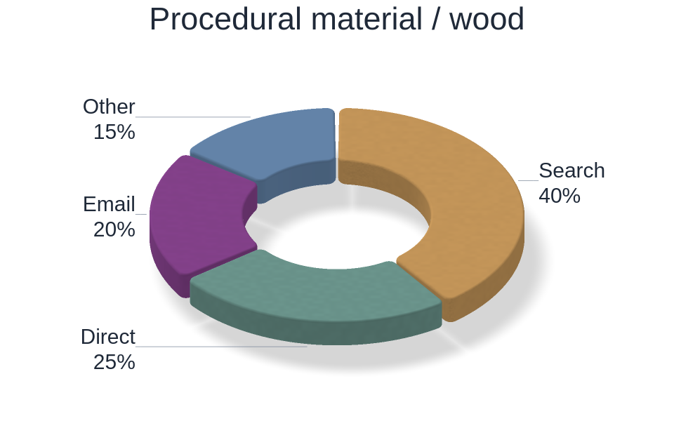

# Python examples

Start with [edit_and_reuse.py](edit_and_reuse.py) to edit a chart, copy executable
Python and apply the result to independent datasets. The
[README animation](../README.md) shows the complete workflow, including an actual
VS Code paste and terminal run.

Run commands from the repository root after installing the package:

```bash
python -m pip install .
python examples/edit_and_reuse.py --output output/edit-and-reuse
```

## Chart gallery

Every gallery script defines `make_figure()` and uses synthetic data. Random
examples use a fixed seed. The checked-in images are native renderer exports,
not mockups or upstream Rust screenshots.

| Preview | Python source | What it demonstrates |
| --- | --- | --- |
| [](pie_chart.py) | [pie_chart.py](pie_chart.py) | Bounded category values, outside labels and exploded slices |
| [](donut_chart.py) | [donut_chart.py](donut_chart.py) | Ceramic, tilt, depth, rounded corners, bevel and shadow |
| [](material_textures.py) | [material_textures.py](material_textures.py) | Procedural paper/wood/hatch/pearl; choose `--material` |
| [](sketch_style.py) | [sketch_style.py](sketch_style.py) | Warm ivory canvas, deterministic path wobble and bundled Comic Neue handwriting |
| [](constellation_style.py) | [constellation_style.py](constellation_style.py) | Stars at marker-line samples with translucent connections |
| [](milkyway_style.py) | [milkyway_style.py](milkyway_style.py) | Line-only star chains and nebula ribbons; scatter is disabled |
| [](line_signals.py) | [line_signals.py](line_signals.py) | 100,000 samples, multiple lines and dashed envelopes |
| [](scatter_clusters.py) | [scatter_clusters.py](scatter_clusters.py) | Seeded clouds, transparency and marker shapes |
| [](parametric_curves.py) | [parametric_curves.py](parametric_curves.py) | Parametric X/Y coordinates, palettes and a grid-free view |
| [](log_scales.py) | [log_scales.py](log_scales.py) | Positive limits, logarithmic X/Y and line styles |
| [](line_markers.py) | [line_markers.py](line_markers.py) | Smooth model, connected measurements and legend placement |
| [](heatmap_field.py) | [heatmap_field.py](heatmap_field.py) | Float32 matrix, physical extent, bilinear shading and RdBu |
| [](correlation_matrix.py) | [correlation_matrix.py](correlation_matrix.py) | Discrete matrix cells, inverted Y and a shared color range |
| [](spectrogram.py) | [spectrogram.py](spectrogram.py) | NumPy windowed FFT and a Magma heatmap; no SciPy required |

Export a single chart:

```bash
python examples/line_signals.py
python examples/heatmap_field.py --output output/field.png
```

Open a native window, edit, then close it to save the current chart:

```bash
python examples/scatter_clusters.py --show
```

All gallery scripts accept `--output` and `--show`. Their default exports go to
`output/gallery/`. Shared argument handling and title/label setup live in
[_gallery.py](_gallery.py); the chart/data construction is in each linked script.
Gallery examples require NumPy and the installed native package only.

```bash
python examples/donut_chart.py --show
python examples/material_textures.py --material pearl --show
python examples/sketch_style.py
python examples/constellation_style.py
python examples/milkyway_style.py
```

Reproduce the checked-in images and their adapter/hash metadata:

```bash
python scripts/render_gallery.py
# Keep the checked-in gallery intact and export elsewhere:
python scripts/render_gallery.py --output output/gallery
```

The [manifest](../docs/images/gallery/manifest.json) records each source/image
pair, canvas dimensions, GPU adapter and PNG SHA-256. The gallery currently
contains 17 images built from the exposed Python chart/style APIs. It includes
four separate material variants from `material_textures.py`. See the
[chart and style reference](../docs/CHART_TYPES.md) for all constructors and
supported combinations. Pies/donuts, categorical bars, boxplots, histograms and
contours are available in both native windows and Jupyter WebGPU; the gallery
is a selection of examples, not the complete API surface.

## Editing and host examples

| Example | Command | Result |
| --- | --- | --- |
| [Edit and reuse](edit_and_reuse.py) | `python examples/edit_and_reuse.py` | Edit one chart; closing it exports code and opens three styled datasets |
| [Desktop editor](desktop_editor.py) | `python examples/desktop_editor.py` | Open the native editor with an adjusted layout |
| [Multiple windows](multiple_windows.py) | `python examples/multiple_windows.py` | Independent figures on a shared main-thread event loop |
| [Quick start](quickstart.py) | `python examples/quickstart.py` | Write `signal.png`, then open a chart window |
| [Jupyter notebook](interactive.ipynb) | `jupyter lab examples/interactive.ipynb` | Edit in the browser using WASM/WebGPU |
| [Notebook cells](notebook.py) | Run cells in an IPython kernel | Script-form notebook example with async export |

For Jupyter, install `python -m pip install jupyterlab ".[notebook]"`. Native
window creation/event processing belongs on Python's main thread. See the
[desktop guide](../docs/DESKTOP_EDITOR.md), [host guide](../docs/HOSTS.md) and
[demo reproduction](../docs/README_DEMO.md) for controls and lifecycle details.
